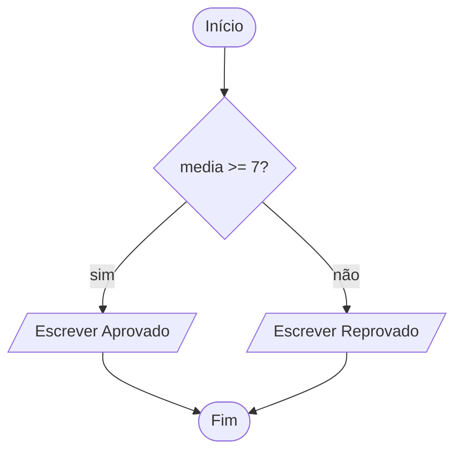

> [!abstract] Definição
> **Um algoritmo desenhado com caixas ligadas por setas.** Cada formato de caixa tem um significado, e as setas mostram a ordem dos passos.

| Forma | Quer dizer |
|---|---|
| oval | início ou fim |
| retângulo | uma ação: calcular, guardar um valor |
| losango | uma pergunta, com um caminho para cada resposta |
| paralelogramo | entrada ou saída de dados |
| seta | a ordem dos passos |

O fluxograma mostra melhor do que o texto os pontos em que o caminho se divide. Em código, o losango vira uma [[glossario/condicional|condicional]], o `if`. Ver a aula [[programacao/logica-de-programacao/modulo-1/04-do-pseudocodigo-ao-fluxograma|Do pseudocódigo ao fluxograma]].

## De onde vem a ideia

Em 1921, o casal americano Frank e Lillian Gilbreth apresentou a engenheiros o *flow process chart*, para registrar o fluxo de um trabalho em fábricas. Em 1947, Herman Goldstine e John von Neumann usaram diagramas assim para planejar programas de computador. Os símbolos foram padronizados nos anos 1960, e a norma atual, a ISO 5807, é de 1985.

## De onde vem a palavra

| Parte | Origem | Sentido |
|---|---|---|
| *fluxo* | latim *fluxus*, de *fluere* | o que corre, como a água |
| *-grama* | grego *grámma*, de *gráphein* ("escrever") | o que se escreveu ou desenhou |

Um fluxograma é o **desenho do fluxo**, por onde o algoritmo corre.

> [!example] Parentes da palavra
> - De *fluere*: **fluir**, **fluido**, **influência** (de *influere*, "correr para dentro") e **afluente** (de *affluere*, "correr para junto").
> - De *grámma*: **diagrama**, **telegrama** e **programa**. Ver [[glossario/programar|programar]].

Fontes: Wikipedia: [Flowchart](https://en.wikipedia.org/wiki/Flowchart) · Wiktionary: [fluxograma](https://pt.wiktionary.org/wiki/fluxograma), [fluxus](https://en.wiktionary.org/wiki/fluxus), [fluō](https://en.wiktionary.org/wiki/fluo), [γράμμα](https://en.wiktionary.org/wiki/γράμμα)
