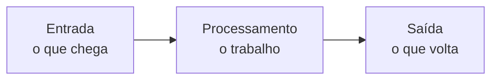
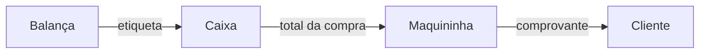

Terceira aula do curso. Já se viu o que é um [[glossario/algoritmo|algoritmo]] e [[programacao/logica-de-programacao/pensando-como-programador|como quebrar um problema em partes]]. Agora, o formato que quase todo programa tem: **recebe algo, trabalha em cima disso e devolve um resultado**.



> [!example] Você também funciona assim
> Alguém pergunta: "quanto é 7 vezes 8?"
> - **Entrada**: a pergunta, que chega pelos ouvidos.
> - **Processamento**: a conta, feita de cabeça.
> - **Saída**: "56", em voz alta.

## [[glossario/entrada|Entrada]]: o que chega

É tudo o que o programa recebe para trabalhar. Nem sempre vem de uma pessoa:

- **de alguém**: o que se digita, o toque na tela, a voz no microfone, a foto da câmera
- **de um aparelho**: o termômetro, o GPS, o relógio do sistema
- **de outro lugar**: um arquivo salvo, a resposta de um site, a mensagem de outro programa

Sem entrada, não há com o que trabalhar. Para somar dois números, alguém precisa dizer **quais** números.

## [[glossario/processamento|Processamento]]: o trabalho no meio

É o que o programa faz com a entrada: somar, comparar, ordenar, filtrar, decidir. É aqui que fica o algoritmo.

Quem usa o programa quase nunca vê essa parte. Vê só o que entrou e o que saiu. No buscador, você digita uma palavra e aparece uma lista de páginas. O que aconteceu entre uma coisa e outra fica escondido.

## [[glossario/saida|Saída]]: o que volta

É o resultado entregue depois do processamento: um texto ou número na tela, um som, a vibração do celular, um arquivo salvo, uma mensagem para outro programa.

Neste curso, a saída vai aparecer quase sempre no **[[glossario/console|console]]**, a janela de texto onde o JavaScript escreve mensagens. Ele já entra em cena na próxima aula.

## O ciclo em coisas do dia a dia

| Situação | Entrada | Processamento | Saída |
|---|---|---|---|
| Catraca do metrô | o cartão encostado no leitor | ver se há saldo e descontar a passagem | luz verde e catraca liberada, ou um bipe de erro |
| GPS | o destino digitado e a posição atual | calcular o melhor caminho | a rota no mapa e a voz dizendo onde virar |
| Corretor ortográfico | o texto digitado | comparar cada palavra com um dicionário | sublinhado vermelho nas palavras erradas |
| Caixa eletrônico | o valor do saque | conferir se o saldo cobre o saque | as notas, ou o aviso de saldo insuficiente |

Repare na catraca e no caixa eletrônico: **o mesmo programa pode dar saídas diferentes**. Quem decide qual delas sai é o processamento, olhando para a entrada.

> [!question] Treine
> Encontre a entrada, o processamento e a saída:
> 1. o tradutor do celular
> 2. a luz do corredor que acende sozinha quando alguém passa
> 3. a balança da padaria

> [!success]- Respostas (clique para abrir)
> 1. **Tradutor**: entra a frase em português, digitada ou falada. O processamento entende o sentido e monta a frase na outra língua. Sai a tradução, na tela ou em voz alta.
> 2. **Luz do corredor**: entra o movimento captado pelo sensor. O processamento é a regra "tem alguém passando? então acende", e depois conta o tempo para apagar. Sai a luz acesa. Ninguém digitou nada: a entrada veio de um sensor.
> 3. **Balança da padaria**: entram o peso do pão e o preço do quilo. O processamento multiplica um pelo outro. Sai a etiqueta com o valor.

## Uma saída vira a entrada da próxima

A etiqueta que a balança imprime é a **saída** dela. No caixa, essa mesma etiqueta vira **entrada**: o leitor lê o código de barras e soma o valor na conta. O total, por sua vez, é a entrada da maquininha do cartão.



Os programas costumam funcionar assim, em corrente: cada um pega o que o anterior entregou, faz a sua parte e passa adiante.

## Comece pelas pontas

Antes de pensar no meio, responda duas perguntas: **o que entra?** e **o que precisa sair?** Com as duas pontas definidas, o processamento é o caminho entre elas.

O exemplo da aula, a média de duas notas, escrito assim:

```js
// Programa: calcular a média de duas notas

// Entrada: nota1 e nota2, digitadas pelo aluno
// Processamento: somar nota1 com nota2 e dividir o resultado por 2
// Saída: mostrar a média na tela

// Exemplo: entram 7 e 9 → (7 + 9) / 2 = 8 → sai 8
```

A última linha é um bom hábito: um caso com números de verdade, resolvido à mão. Quando o código existir (nas próximas aulas), dá para conferir se ele chega ao mesmo resultado.

## Lixo entra, lixo sai

O processamento pode estar perfeito e, mesmo assim, a saída sair errada. Basta a entrada estar errada.

Na média de notas de 0 a 10, se alguém digitar **80** em vez de **8**, junto com um 9, o programa calcula (80 + 9) / 2 = **44,5**. A conta está certa. O erro veio de quem digitou, e o programa não tinha como saber.

Programadores têm uma frase para isso desde o fim dos anos 1950: *garbage in, garbage out*, "lixo entra, lixo sai". A ideia é ainda mais antiga. Em 1864, Charles Babbage, inventor de máquinas de calcular, contou que duas vezes já lhe tinham perguntado:

> [!quote] Charles Babbage, 1864
> "Por favor, sr. Babbage, se o senhor puser números errados na máquina, as respostas certas vão sair?"

Ele escreveu que não conseguia entender a confusão de ideias que levaria alguém a fazer essa pergunta.

## De onde vêm as palavras

- **[[glossario/entrada|Entrada]]**: do latim *intrāre*, formado de *intrā*, "dentro". **Ir para dentro.**
- **[[glossario/processamento|Processamento]]**: de *processo*, do latim *prōcessus*, de *prō-* (para a frente) + *cēdere* (ir). **O que vai andando para a frente**, passo a passo. *Procissão* vem da mesma família.
- **[[glossario/saida|Saída]]**: do latim *salīre*, **pular**. Sair era dar um pulo para fora. **Resultado** é da mesma família: vem de *resultāre*, "pular de volta". As duas palavras que a aula usa para o fim do ciclo nascem de um pulo.
- **[[glossario/console|Console]]**: em francês, um suporte preso na parede. O nome passou para o móvel de comando do órgão de tubos, depois para os painéis de controle das máquinas e, por fim, para os computadores.

O inglês, que aparece muito na programação, montou esses termos com peças simples: **input** (*in*, dentro + *put*, pôr) e **output** (*out*, fora + *put*). Juntos, viram a sigla **I/O**.

> [!tip] Para guardar
> - Quase todo programa **recebe algo, trabalha em cima disso e devolve um resultado**.
> - Antes de programar, defina as pontas: **o que entra e o que precisa sair**. O meio é o caminho entre elas.
> - A saída de um programa muitas vezes é a entrada de outro.
> - Entrada errada dá saída errada. O programa não adivinha.

Fontes: Wikipedia: [Garbage in, garbage out](https://en.wikipedia.org/wiki/Garbage_in,_garbage_out)
