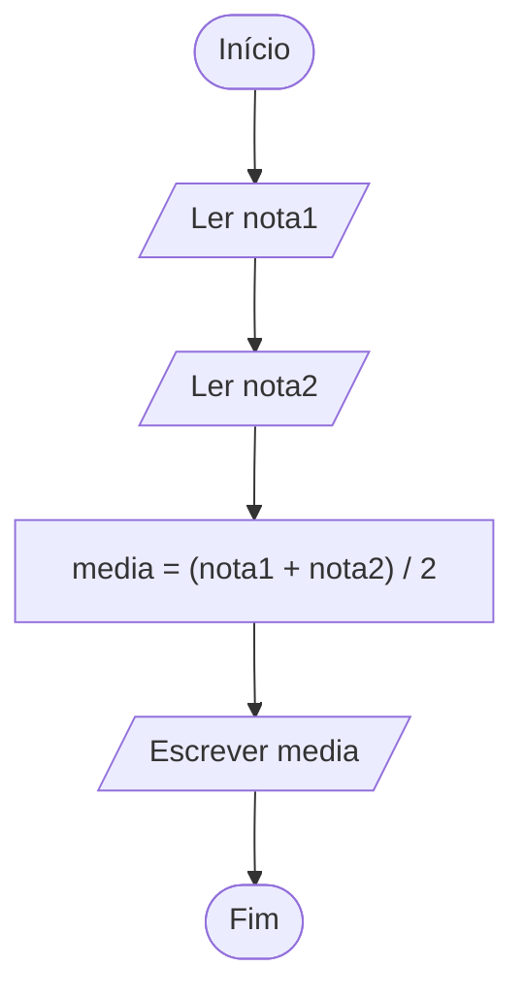
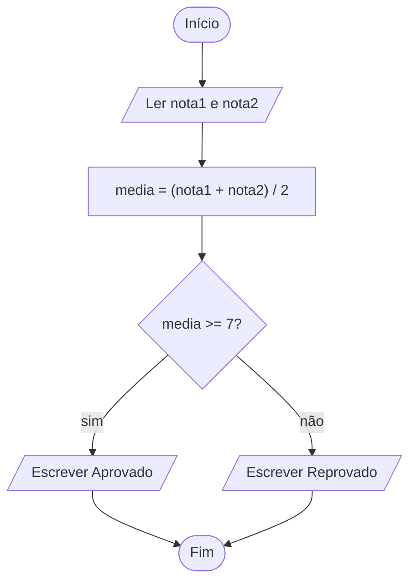

Quarta aula do módulo 1. A [[programacao/logica-de-programacao/modulo-1/03-entrada-processamento-saida|aula anterior]] terminou com o programa da média escrito em comentários: um rascunho, em português, do que o código ia fazer. Esta aula dá nome a esse hábito e mostra dois jeitos de rascunhar um algoritmo antes de programar: um em texto, o **[[glossario/pseudocodigo|pseudocódigo]]**, e outro em desenho, o **[[glossario/fluxograma|fluxograma]]**.

## Por que rascunhar

Ninguém constrói uma casa sem planta. Na planta, mudar uma parede de lugar custa uma borracha. Com a casa pronta, custa uma obra.

Com programas é parecido. Quem escreve direto em JavaScript divide a cabeça em duas: uma parte pensa no problema, e a outra cuida do parêntese que faltou, da vírgula e do ponto e vírgula. O rascunho separa as duas tarefas. Primeiro se resolve **o quê**: quais passos e em que ordem. Só depois vem o **como**, a [[glossario/sintaxe|sintaxe]] da linguagem.

Nem o pseudocódigo nem o fluxograma são linguagens de programação. O computador não roda nenhum dos dois. Eles são feitos para pessoas lerem.

## Pseudocódigo: o algoritmo em texto

É o algoritmo escrito em português, um passo por linha, com algumas palavras fixas para marcar as partes. A média de duas notas, da aula 1.3, fica assim:

```text
INICIO
  LER nota1
  LER nota2
  media = (nota1 + nota2) / 2
  ESCREVER media
FIM
```

Cada linha tem um papel, e são os papéis da [[programacao/logica-de-programacao/modulo-1/03-entrada-processamento-saida|aula 1.3]]:

| Linha | O que faz | Parte do ciclo |
|---|---|---|
| `INICIO` e `FIM` | marcam onde o algoritmo começa e termina | as pontas |
| `LER nota1` e `LER nota2` | recebem os valores | entrada |
| `media = (nota1 + nota2) / 2` | faz a conta | processamento |
| `ESCREVER media` | mostra o resultado | saída |

O recuo das linhas do meio não é obrigatório. Ele só deixa à vista o que fica entre o `INICIO` e o `FIM`.

### Não tem regra oficial

Não existe um pseudocódigo oficial. Um livro escreve `LER`, e outro escreve `LEIA`. Um usa `=` para guardar o valor, e outro usa uma seta: `media ← (nota1 + nota2) / 2`. A seta tem uma vantagem, que a [[programacao/logica-de-programacao/modulo-2/04-comparacoes|aula 2.4]] explica: mostra que o valor **vai para** a variável, e deixa o `=` livre para comparar. O que importa é que qualquer pessoa consiga ler e seguir os passos.

> [!info] Pseudocódigo que roda
> Muitos cursos de lógica no Brasil usam o **VisuAlg**, um programa lançado em 1996 que executa pseudocódigo em português. Ele usa uma variação do **Portugol**, uma família de linguagens baseadas no português. Nele, o rascunho deixa de ser só rascunho, porque dá para rodar e ver o resultado.

## Fluxograma: o algoritmo em desenho

No fluxograma, o mesmo algoritmo vira caixas ligadas por setas. Cada formato de caixa quer dizer uma coisa:

| Forma | Quer dizer | Exemplo |
|---|---|---|
| oval | início ou fim | Início, Fim |
| retângulo | uma ação, como calcular ou guardar um valor | `media = (nota1 + nota2) / 2` |
| losango | uma pergunta, com um caminho para cada resposta | `media >= 7?` |
| paralelogramo | entrada ou saída de dados | Ler nota1, Escrever media |
| seta | a ordem: de qual passo se vai para qual | |

A aula usa o retângulo também para ler e mostrar valores, o que é comum em fluxogramas simples. Os mais formais têm uma forma só para a entrada e a saída: o paralelogramo, que aparece nos desenhos abaixo.

A média, desenhada:



Sem desvios, o fluxograma vira uma fila reta e não mostra nada que o pseudocódigo já não mostrasse. Ele brilha quando o caminho se divide. Com uma pergunta a mais, "a média dá aprovação?", fica assim:



Os dois caminhos ficam à vista ao mesmo tempo, e dá para seguir cada um com o dedo. Num texto corrido, isso é bem mais difícil. O losango vira código no módulo 3, com o `if` da [[programacao/logica-de-programacao/modulo-3/01-tomando-decisoes-com-if|aula 3.1]].

### Quando vale a pena desenhar

Para um programa de cinco linhas, não precisa. O fluxograma ajuda quando:

- o caminho se divide muitas vezes, e é fácil se perder;
- é preciso explicar o algoritmo para alguém que não programa, porque caixas e setas qualquer um lê;
- algo deu errado, e se quer seguir o caminho passo a passo para achar onde.

> [!info]- De onde vem o fluxograma (clique para abrir)
> - **1921**: o casal americano Frank e Lillian Gilbreth apresenta à Sociedade Americana de Engenheiros Mecânicos (ASME) o *flow process chart*, um diagrama que registra, passo a passo, o fluxo de um trabalho. Era para fábricas, e não para computadores: os Gilbreth estudavam como fazer o trabalho com menos movimentos e menos desperdício.
> - **1947**: Herman Goldstine e John von Neumann usam diagramas desse tipo para planejar programas de computador. No mesmo ano, a ASME adota um conjunto de símbolos baseado no trabalho dos Gilbreth.
> - **Anos 1960**: o instituto americano de normas técnicas (ANSI) padroniza os símbolos. Em 1970, a organização internacional de normas (ISO) adota os mesmos.
> - **1985**: sai a norma ISO 5807, que ainda está em vigor.

## Três formas do mesmo algoritmo

Pseudocódigo, fluxograma e JavaScript podem descrever exatamente o mesmo algoritmo:

| Forma | Feita de | Quem lê |
|---|---|---|
| pseudocódigo | texto organizado | pessoas |
| fluxograma | caixas e setas | pessoas |
| código | uma linguagem de programação | pessoas **e** o computador |

A média em JavaScript, como vai aparecer na [[programacao/logica-de-programacao/modulo-2/01-variaveis-let-e-const|aula 2.1]], fica assim. Por enquanto, as notas vêm escritas no próprio código, no lugar do `LER`:

```js
const nota1 = 7;
const nota2 = 9;
const media = (nota1 + nota2) / 2;
console.log(media); // 8
```

Nenhuma das três formas é "mais certa". O algoritmo é o mesmo, e só muda a roupa. O pseudocódigo e o fluxograma servem para pensar. O código é a versão que roda, e é aí que entra a [[programacao/logica-de-programacao/modulo-1/05-seu-primeiro-codigo-console-log|próxima aula]].

> [!tip] O rascunho também serve depois
> Cada linha do pseudocódigo pode virar um comentário `//` em cima do trecho de código que faz aquele passo, como na aula 1.3. O rascunho vira o roteiro do programa.

## Treine

Tente responder antes de abrir a resposta, logo abaixo de cada pergunta.

> [!question] 1. O total da compra
> Escreva em pseudocódigo um algoritmo que lê o preço de um produto e a quantidade comprada, e mostra o total.
>
> > [!success]- Resposta
> > Uma resposta possível (o `*` é o "vezes" da programação, como se vê na aula 2.3):
> >
> > ```text
> > INICIO
> >   LER preco
> >   LER quantidade
> >   total = preco * quantidade
> >   ESCREVER total
> > FIM
> > ```

> [!question] 2. As formas do fluxograma
> Que forma o fluxograma usa para cada passo? (a) "Início" (b) "total = preco * quantidade" (c) "o total passa de 100?" (d) "Escrever total"
>
> > [!success]- Resposta
> > (a) oval; (b) retângulo; (c) losango; (d) paralelogramo, ou retângulo nos fluxogramas mais simples.

> [!question] 3. Descreva, seta por seta, o fluxograma do item 1.
>
> > [!success]- Resposta
> > Início → Ler preco → Ler quantidade → total = preco * quantidade → Escrever total → Fim.

> [!question] 4. Este pseudocódigo tem um problema de ordem. Qual é?
> ```text
> INICIO
>   ESCREVER area
>   LER largura
>   LER altura
>   area = largura * altura
> FIM
> ```
>
> > [!success]- Resposta
> > O `ESCREVER area` vem antes de a área ser calculada, e antes até de a largura e a altura serem lidas. Na hora de mostrar, não há nada para mostrar. Os passos estão certos, mas fora de ordem, e a [[programacao/logica-de-programacao/modulo-1/01-o-que-e-programar-e-algoritmo|aula 1.1]] já avisava: a ordem faz parte da solução. O `ESCREVER area` deve ser o último passo antes do `FIM`.

## De onde vêm as palavras

- **[[glossario/pseudocodigo|Pseudocódigo]]**: *pseudo-* vem do grego *pseudḗs*, "falso, mentiroso", do verbo *pseúdō*, "mentir". É o mesmo de **pseudônimo**, o nome falso que um autor usa. O pseudocódigo é um "código de mentira": parece código, mas nenhum computador o executa. E [[glossario/codigo|código]] vem do latim *cōdex*, que começou como **tronco de árvore**.
- **[[glossario/fluxograma|Fluxograma]]**: *fluxo* + *-grama*. *Fluxo* vem do latim *fluxus*, de *fluere*, "correr, fluir", como a água. Da mesma família vêm **fluir**, **fluido**, **influência** (de *influere*, "correr para dentro") e **afluente** (de *affluere*, "correr para junto": o rio que deságua em outro). *-grama* vem do grego *grámma*, "o que se escreveu ou desenhou", de *gráphein*, "escrever". É o mesmo *-grama* de **diagrama**, **telegrama** e **programa** (ver [[glossario/programar|programar]]). Um fluxograma é o **desenho do fluxo**, por onde o algoritmo corre.
- **Rascunho**: do espanhol *rascuño*, de *rascar*, "arranhar, riscar". No começo, era um arranhão, um risco. Depois, a palavra passou a querer dizer os primeiros traços de uma obra. Rascunhar é riscar à vontade antes de passar a limpo.
- **Losango**: do francês *losange*, de origem incerta. Uma hipótese liga a palavra ao gaulês *\*lausā*, "laje de pedra". Outra, ao francês antigo *losenge*, "bajulação, elogio falso".

> [!tip] Para guardar
> - Antes de programar, rascunhe: primeiro **o quê** (os passos e a ordem), depois **o como** (a sintaxe).
> - Pseudocódigo é o algoritmo em texto, em português, um passo por linha. Não tem regra oficial: basta ser claro.
> - Fluxograma é o algoritmo em desenho: oval para início e fim, retângulo para ação, losango para pergunta, paralelogramo para entrada e saída e setas para a ordem.
> - Pseudocódigo, fluxograma e código são o mesmo algoritmo em três roupas. Só o código roda no computador.

Fontes: Wikipedia: [Pseudocode](https://en.wikipedia.org/wiki/Pseudocode), [Flowchart](https://en.wikipedia.org/wiki/Flowchart), [Visualg](https://pt.wikipedia.org/wiki/Visualg), [Portugol](https://pt.wikipedia.org/wiki/Portugol) · Wiktionary: [pseudo-](https://en.wiktionary.org/wiki/pseudo-), [ψευδής](https://en.wiktionary.org/wiki/ψευδής), [fluxus](https://en.wiktionary.org/wiki/fluxus), [fluō](https://en.wiktionary.org/wiki/fluo), [γράμμα](https://en.wiktionary.org/wiki/γράμμα), [fluxograma](https://pt.wiktionary.org/wiki/fluxograma), [rascunho](https://pt.wiktionary.org/wiki/rascunho), [losange](https://en.wiktionary.org/wiki/losange)
