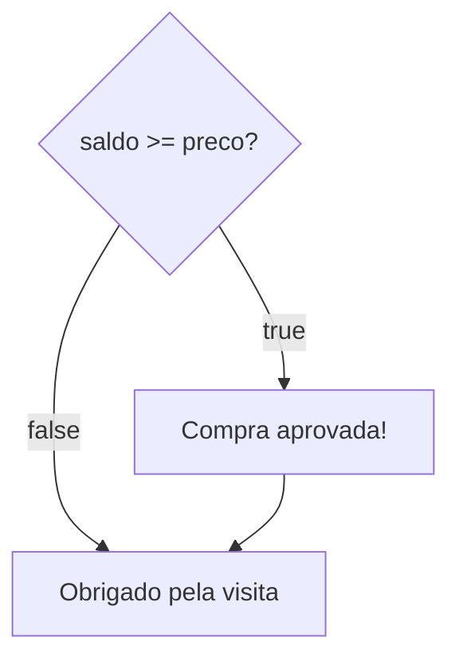

Primeira aula do módulo 3, o das decisões no código. Até aqui, todo programa andava em linha reta: começava na primeira linha e ia até a última, sem pular nada. Só que quase todo programa útil precisa **escolher**. O caixa só aprova a compra se houver saldo, o site só mostra o perfil para quem entrou na conta, e o jogo só anuncia a vitória se a pontuação bater a meta.

As peças para fazer as perguntas já estão prontas. As [[programacao/logica-de-programacao/modulo-2/04-comparacoes|comparações]] respondem `true` ou `false`, e os [[programacao/logica-de-programacao/modulo-2/05-operadores-logicos|operadores lógicos]] juntam essas respostas. Faltava o que **fazer** com a resposta. Esse é o trabalho do `if`.

## Se chover, leve o guarda-chuva

Toda decisão do dia a dia tem duas partes: uma **[[glossario/condicional|condição]]** e uma ação que depende dela.

| Frase | Condição | Ação |
|---|---|---|
| Se chover, levo o guarda-chuva. | chover | levar o guarda-chuva |
| Se houver saldo, a compra é aprovada. | haver saldo | aprovar a compra |

Quando a condição não vale, a ação não acontece, e o dia segue normalmente. Ninguém fica parado na porta porque não choveu.

Em JavaScript, a frase fica quase igual. Só troca o "se" pelo `if`, que é "se" em inglês:

```js
const chovendo = true;

if (chovendo) {
  console.log("Leve o guarda-chuva");
}
```

## As três partes do `if`

```js
if (saldo >= preco) {
  console.log("Compra aprovada!");
}
```

1. **A palavra `if`**.
2. **A condição, entre parênteses**: `(saldo >= preco)`. É uma pergunta, e precisa dar `true` ou `false`.
3. **O [[glossario/bloco|bloco]], entre chaves** `{ }`: o que roda quando a resposta é `true`.

Se a resposta for `false`, o JavaScript pula o bloco inteiro e continua na primeira linha depois do `}`.

## Os dois caminhos

```js
const saldo = 200;
const preco = 150;

if (saldo >= preco) {
  console.log("Compra aprovada!");
}

console.log("Obrigado pela visita");
```

| `saldo` | `saldo >= preco` | O que aparece |
|---|---|---|
| 200 | `true` | `Compra aprovada!` e depois `Obrigado pela visita` |
| 100 | `false` | só `Obrigado pela visita` |

O "Obrigado pela visita" aparece nos dois casos, porque está fora das chaves. O `if` só manda no que está dentro do bloco dele.



Num fluxograma, a pergunta é um losango: entra um caminho e saem dois. Repare que os dois caminhos se juntam de novo logo depois. O `if` é um desvio, e não uma estrada nova: quem passa pelo bloco volta para o mesmo lugar de quem pulou.

## O que vai nos parênteses

Qualquer coisa que dê `true` ou `false`. Tudo o que apareceu nas aulas 2.4 e 2.5 serve:

```js
// uma comparação
if (nota >= 7) {
  console.log("Aprovado");
}

// comparações juntadas com &&
if (idade >= 18 && temCarteira) {
  console.log("Pode dirigir");
}

// o "não"
if (!estaLogado) {
  console.log("Entre na sua conta para continuar");
}
```

A aula 2.5 tinha avisado que, com as decisões, o `!` ia aparecer o tempo todo. Aí está: "se **não** estiver logado, peça para entrar" vira `if (!estaLogado)`.

> [!tip] Não precisa de `=== true`
> `if (temEstoque === true)` funciona, mas pergunta duas vezes: `temEstoque` já é `true` ou `false`. Basta `if (temEstoque)`, que se lê "se tem estoque". É por isso que vale dar nome de pergunta às variáveis booleanas, como na aula 2.4.

## Sempre com chaves

Sem chaves, o `if` fica só com a **primeira** instrução depois dele. O resto roda sempre, mesmo que esteja recuado como se fizesse parte do `if`:

```js
const saldo = 100;
const preco = 150;

if (saldo >= preco)
  console.log("Compra aprovada!");
  console.log("Produto enviado!"); // parece estar no if, mas não está

// saída: Produto enviado!
```

O saldo não dava, e o produto foi enviado mesmo assim. O recuo, os espaços no começo da linha, existe para quem lê, e o JavaScript o ignora. Para ele, o código acima é este:

```js
if (saldo >= preco) {
  console.log("Compra aprovada!");
}
console.log("Produto enviado!");
```

Com chaves sempre, mesmo quando o bloco tem uma linha só, não há como errar: o que está entre as chaves é do `if`, e o que está fora não é.

> [!info]- O bug do *goto fail* (clique para abrir)
> Em fevereiro de 2014, a Apple soltou uma atualização de segurança para o iPhone (iOS) e para o Mac (OS X). O problema estava num `if` sem chaves, no código que confere as conexões seguras, as do cadeado no navegador:
>
> ```c
> if ((err = SSLHashSHA1.update(&hashCtx, &signedParams)) != 0)
>     goto fail;
>     goto fail;
> if ((err = SSLHashSHA1.final(&hashCtx, &hashOut)) != 0)
>     goto fail;
> ```
>
> A linha `goto fail;` ("vá para a saída de falha") saiu duplicada. A primeira pertencia ao `if`. A segunda, apesar do recuo, rodava sempre, e pulava o resto da conferência da assinatura digital do servidor, uma das provas de que um site é mesmo quem diz ser. Como até ali tudo tinha dado certo, a função saía dizendo "sucesso". Na prática, essa conferência passava sempre, fosse a assinatura verdadeira ou não.
>
> O código é em C, e não em JavaScript. Mas a regra do `if` sem chaves é a mesma, porque o JavaScript herdou o `if` do C. A correção saiu no iOS 7.0.6 e no OS X 10.9.2.

## Cuidado com o `=` dentro do `if`

A [[programacao/logica-de-programacao/modulo-2/04-comparacoes|aula 2.4]] mostrou que o `=` guarda e o `===` pergunta. Dentro de um `if`, a troca faz dois estragos de uma vez:

```js
let idade = 15;

if (idade = 18) {
  console.log("Maior de idade");
}

console.log(idade);

// saída:
// Maior de idade
// 18
```

1. O `=` não perguntou nada: **guardou** 18 em `idade`, e os 15 se perderam.
2. O `if` recebeu o valor guardado, 18, no lugar de uma resposta. Como na aula 2.5 com o `!15`, um número diferente de zero conta como verdadeiro. Então o bloco rodou.

O engano também funciona ao contrário. Com zero, o bloco **nunca** roda:

```js
let pontos = 50;

if (pontos = 0) {
  console.log("Fim de jogo"); // nunca aparece: 0 conta como falso
}
// e pontos agora vale 0
```

Nada disso dá erro, e o programa segue com o valor errado. Três defesas:

- **Use `===`** para comparar, sempre.
- **Use `const`** quando o valor não vai mudar. Com `const`, o mesmo engano dá `TypeError: Assignment to constant variable.`, e o problema aparece na hora.
- **Use um [[glossario/linter|linter]].** No ESLint, a regra `no-cond-assign` ("sem atribuição na condição") vem ligada no conjunto recomendado e aponta exatamente esse engano.

> [!info]- Verdadeiro e falso "de mentirinha" (clique para abrir)
> O `if` espera um booleano. Quando recebe outra coisa, o JavaScript converte. Contam como falso o `false`, o `0`, o texto vazio `""` e mais uns poucos valores que ainda vão aparecer no curso. Todo o resto conta como verdadeiro, inclusive os textos `"0"` e `"false"`, porque não estão vazios. Em inglês, esses valores se chamam *truthy* e *falsy*, algo como "com jeito de verdadeiro" e "com jeito de falso".

## `if` ou `&&`?

Na aula 2.5, no [[glossario/curto-circuito|curto-circuito]], o `&&` já decidia se uma coisa rodava ou não:

```js
false && console.log("oi"); // não mostra nada
true && console.log("oi");  // mostra oi
```

Então estas duas formas fazem a mesma coisa:

```js
estaLogado && console.log("Bem-vindo de volta!");

if (estaLogado) {
  console.log("Bem-vindo de volta!");
}
```

Para que serve o `if`, então? Os dois foram feitos para coisas diferentes:

- O `&&` é um **operador**, como o `+`: ele **calcula** um valor. O lugar dele é onde se precisa de uma resposta, para guardar numa variável, mostrar no console ou pôr nos parênteses de um `if`.
- O `if` é uma **instrução**: não calcula nada. Ele **decide** se um bloco roda ou não.

É parecido com a divisão da aula 2.4, em que o `=` manda e o `===` pergunta. Aqui, o `&&` **responde** e o `if` **age**.

| Você quer... | Use | Exemplo |
|---|---|---|
| uma resposta, `true` ou `false` | `&&` (ou `\|\|`, ou `!`) | `const podeDirigir = idade >= 18 && temCarteira;` |
| fazer algo só em certos casos | `if` | `if (podeDirigir) { console.log("Pode dirigir"); }` |

Quase sempre, os dois trabalham juntos: o `&&` monta a pergunta, e o `if` age com a resposta.

```js
if (idade >= 18 && temCarteira) {
  console.log("Pode dirigir");
}
```

### Por que não usar o `&&` como um `if` disfarçado

O atalho `condição && ação()` funciona, mas sai perdendo:

- **Cabe uma ação só.** No bloco do `if`, cabem quantas linhas forem necessárias.
- **Não tem "senão".** O `if` pode ganhar um `else` ("senão"), para fazer outra coisa quando a resposta é `false`. O `&&` não tem isso.
- **Lê pior.** `if (estaLogado)` se lê "se estiver logado". A linha com `&&` parece uma pergunta cuja resposta foi jogada fora, e é isso mesmo: o `&&` calcula um valor que ninguém guarda.
- **Linters reclamam.** O ESLint tem a regra `no-unused-expressions` ("sem expressões cujo resultado não é usado"). Quando ligada, ela aponta `a && b()` como erro.

Em resumo: **para perguntar, `&&`. Para agir, `if`.**

> [!info]- Onde o `&&` faz papel de `if`: o React (clique para abrir)
> No [[glossario/react|React]], o `&&` aparece no lugar do `if` o tempo todo:
>
> ```jsx
> {temMensagens && <p>Você tem mensagens novas</p>}
> ```
>
> Entre as chaves do JSX vai um **valor**, e o `if`, que não é um valor, não cabe ali. Já o `&&` calcula um valor, com um detalhe que a aula 2.5 não contou: ele não devolve só `true` ou `false`, e sim **um dos dois lados**. Se o esquerdo contar como falso, devolve o esquerdo. Se não, devolve o direito. Com `temMensagens` verdadeiro, o resultado é o parágrafo, que aparece na tela. Com `false`, o React não desenha nada.
>
> A armadilha é pôr um número na esquerda. Em `quantidade && <p>...</p>`, se `quantidade` valer 0, o `&&` devolve o 0, e o React mostra um "0" na tela. A saída é comparar: `quantidade > 0 && <p>...</p>`.
>
> A própria documentação do React diz que esses atalhos são opcionais: quem preferir pode usar um `if` comum, fora do JSX.

## Lógica ou JavaScript?

Toda linguagem tem um "se". Muda o jeito de marcar onde o bloco começa e termina:

| A ideia | JavaScript | Python | Pseudocódigo | Planilha (Excel) |
|---|---|---|---|---|
| se | `if (idade >= 18) { ... }` | `if idade >= 18:` | `se idade >= 18 entao ... fimse` | `=SE(A1>=18; "Pode entrar"; "")` |
| o bloco | entre `{` e `}` | as linhas recuadas | entre `entao` e `fimse` | (não tem bloco) |

O Python não usa chaves: **o recuo é o bloco**.

```python
if idade >= 18:
    print("Pode entrar")
print("Fim")
```

A linha recuada é do `if`. A que voltou para a margem não é. Por isso, a armadilha do "parece estar dentro, mas não está" não existe no Python: lá, parecer e estar são a mesma coisa. Em troca, um espaço a mais ou a menos muda o programa.

## Treine

> [!question] O que aparece no console?
> 1. `const nota = 7; if (nota >= 7) { console.log("Aprovado"); } console.log("Fim");`
> 2. O mesmo, mas com `const nota = 6.9;`.
> 3. `const temEstoque = false; if (!temEstoque) { console.log("Esgotado"); }`
> 4. `const idade = 20; const temCarteira = false; if (idade >= 18 && temCarteira) { console.log("Pode dirigir"); }`
> 5. `let pontos = 0; if (pontos = 100) { console.log("Venceu!"); } console.log(pontos);`
> 6. Reescreva com `if`: `ehVip && console.log("Frete grátis");`
> 7. Operador ou `if`? (a) Guardar em `meiaEntrada` se a pessoa é estudante ou tem 60 anos ou mais. (b) Mostrar "Bem-vindo de volta!" para quem está logado.
> 8. E este, sem chaves?
>
> ```js
> const chovendo = false;
> if (chovendo)
>   console.log("Leve o guarda-chuva");
>   console.log("Leve a capa de chuva");
> ```

> [!success]- Respostas (clique para abrir)
> 1. `Aprovado` e depois `Fim`: `7 >= 7` é `true`, porque o `>=` inclui o próprio 7.
> 2. Só `Fim`: `6.9 >= 7` é `false`, e o bloco é pulado. O `console.log("Fim")` está fora dele, então roda.
> 3. `Esgotado`: `temEstoque` é `false`, e `!false` é `true`.
> 4. Nada: o `&&` exige os dois lados, e falta a carteira.
> 5. `Venceu!` e depois `100`. É o engano do `=`: em vez de perguntar, guardou 100 em `pontos`, e 100 conta como verdadeiro. O certo era `if (pontos === 100)`.
> 6. `if (ehVip) { console.log("Frete grátis"); }`
> 7. (a) Uma resposta, então operador: `const meiaEntrada = ehEstudante || idade >= 60;`. (b) Uma ação, então `if`: `if (estaLogado) { console.log("Bem-vindo de volta!"); }`.
> 8. Só `Leve a capa de chuva`. Sem chaves, o `if` fica só com a primeira linha, e a segunda roda sempre, apesar do recuo. Não está chovendo, e o programa manda levar a capa.

## De onde vêm as palavras

- **if**: vem do inglês antigo *ġif*, que soava mais ou menos como "yif", e antes do protogermânico *\*jabai*, "quando, se". O *g* do começo se perdeu pelo caminho. Primos: o alemão *ob* ("se", como em "não sei se...") e o holandês *of* ("ou", "se").
- **[[glossario/condicional|Condição]]**: do latim *condiciō*, de *condīcere*, "combinar, acertar", que é *con-* ("junto") + *dīcere* ("dizer"). A condição nasceu como um **acordo falado**, os termos que duas partes combinaram. O sentido continua em "aceito, **com a condição de** que...". Um `if` é um trato desses: se isso for verdade, faço aquilo. *Dīcere* é o nosso **dizer**, e também está em **ditado**, **dicionário**, **contradizer** e no **veredicto** da aula 2.5.
- **Decisão**: do latim *dēcīdere*, *dē-* ("fora") + *caedere* ("cortar"). Em latim, a palavra queria dizer primeiro "cortar fora, aparar", e só depois "resolver, pôr fim". Decidir é **cortar fora**: das opções, uma fica, e as outras são cortadas. O mesmo *caedere* está em **preciso** (de *praecīdere*, "cortar na frente": o que foi aparado na medida), **conciso** (de *concīdere*, "cortar em pedaços": o texto que foi cortado curto) e **incisão**. O `if` decide no sentido mais literal: corta um caminho fora.
- **[[glossario/bloco|Bloco]]**: do francês *bloc*, do holandês médio *blok*, "tronco de árvore". No francês antigo, *bloc* era uma **tora**. É a mesma imagem do [[glossario/log|log]], que em inglês também é uma tora: duas palavras da programação que nasceram como um pedaço de madeira.
- **[[glossario/curto-circuito|Curto-circuito]]**: *circuito* vem do latim *circuitus*, "volta", de *circum* ("em volta") + *īre* ("ir"). Um circuito é um caminho que dá a volta e retorna ao começo, como a corrente que sai da pilha, passa pela lâmpada e volta. No curto-circuito, do inglês *short circuit*, a corrente acha um caminho mais **curto** e pula a lâmpada. O `&&` faz igual: quando o lado esquerdo já decide a resposta, ele pega o atalho e pula o direito.

> [!tip] Para guardar
> - `if (condição) { ... }`: o bloco só roda se a condição der `true`. Se der `false`, o programa pula o bloco e segue.
> - O que está fora das chaves roda sempre.
> - Use chaves sempre, mesmo com uma linha só. O recuo engana, e as chaves não.
> - Dentro da condição, use `===`, nunca `=`. O `=` estraga a variável e ainda faz o `if` rodar sempre, ou nunca.
> - `&&` responde, `if` age. Use o `&&` para montar a pergunta e o `if` para fazer algo com a resposta.

Fontes: MDN: [if...else](https://developer.mozilla.org/en-US/docs/Web/JavaScript/Reference/Statements/if...else), [Truthy](https://developer.mozilla.org/en-US/docs/Glossary/Truthy) · ESLint: [no-cond-assign](https://eslint.org/docs/latest/rules/no-cond-assign), [no-unused-expressions](https://eslint.org/docs/latest/rules/no-unused-expressions) · React: [Conditional Rendering](https://react.dev/learn/conditional-rendering) · Wikipedia: [Unreachable code (goto fail bug)](https://en.wikipedia.org/wiki/Unreachable_code) · ImperialViolet: [Apple's SSL/TLS bug](https://www.imperialviolet.org/2014/02/22/applebug.html) · Wiktionary: [if](https://en.wiktionary.org/wiki/if), [condiciō](https://en.wiktionary.org/wiki/condicio), [dēcīdō](https://en.wiktionary.org/wiki/decido), [precise](https://en.wiktionary.org/wiki/precise), [concise](https://en.wiktionary.org/wiki/concise), [bloc](https://en.wiktionary.org/wiki/bloc), [circuit](https://en.wiktionary.org/wiki/circuit)
