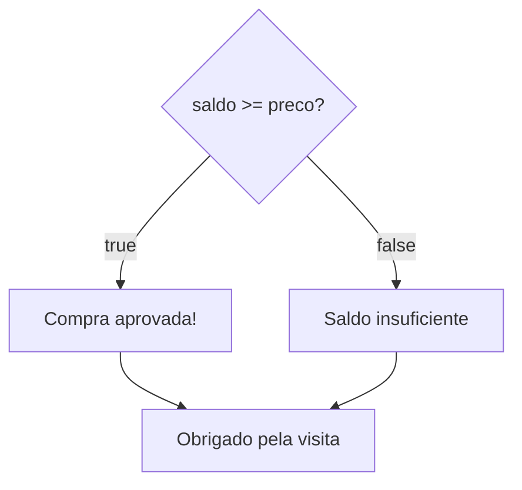

Segunda aula do módulo 3. O `if` da [[programacao/logica-de-programacao/modulo-3/01-tomando-decisoes-com-if|aula 3.1]] escolhe entre fazer e não fazer. Com a condição verdadeira, roda o bloco. Com ela falsa, segue em frente como se nada fosse. Isso basta para um aviso que só vale às vezes. Mas volte ao caixa da aula passada:

```js
if (saldo >= preco) {
  console.log("Compra aprovada!");
}
```

Com saldo de 100 e preço de 150, o programa fica mudo. O cliente não sabe se a compra passou, se travou ou se o sistema caiu. Faltou responder o "não".

## Se..., senão...

Em português, a frase completa é: "**se** houver saldo, aprove a compra; **senão**, avise que o saldo não dá". O "senão" do JavaScript é o `else`:

```js
const saldo = 100;
const preco = 150;

if (saldo >= preco) {
  console.log("Compra aprovada!");
} else {
  console.log("Saldo insuficiente");
}

console.log("Obrigado pela visita");

// saída:
// Saldo insuficiente
// Obrigado pela visita
```

| `saldo` | `saldo >= preco` | Bloco que roda | O que aparece |
|---|---|---|---|
| 200 | `true` | o do `if` | `Compra aprovada!` |
| 100 | `false` | o do `else` | `Saldo insuficiente` |

Nos dois casos, aparece depois o "Obrigado pela visita", que está fora dos dois blocos.



Compare com o [[glossario/fluxograma|fluxograma]] da aula 3.1. Lá, a seta do `false` ia direto para o fim, sem passar por caixa nenhuma. Agora, cada saída do losango tem a sua. É o desenho do "Aprovado ou Reprovado" da [[programacao/logica-de-programacao/modulo-1/04-do-pseudocodigo-ao-fluxograma|aula 1.4]], que finalmente vira código.

## As regras do `else`

### Sempre um bloco, e só um

Só com o `if`, roda um bloco ou nenhum. Com `if` e `else`, roda **sempre exatamente um**:

| Quantos blocos rodam? | Só `if` | `if` + `else` |
|---|---|---|
| condição `true` | 1 (o do `if`) | 1 (o do `if`) |
| condição `false` | nenhum | 1 (o do `else`) |

Nunca os dois juntos, e nunca nenhum. O `else` é **opcional**: só entra quando o "não" também pede uma ação.

### Sem condição própria

O `else` não pergunta nada. Ele quer dizer "em qualquer outro caso", ou seja, quando a condição do `if` deu `false`. Escrever uma condição para ele é erro:

```js
if (idade >= 18) {
  console.log("Maior de idade");
} else (idade < 18) {   // SyntaxError: Unexpected token '{'
  console.log("Menor de idade");
}
```

Nem precisa. Se a idade não é maior ou igual a 18, só pode ser menor. A pergunta já foi feita, e o `else` só cuida da outra resposta.

> [!info]- E se a chave for para a linha de baixo? (clique para abrir)
> Com a `{` na linha seguinte, o mesmo engano não dá erro, e fica pior:
>
> ```js
> const saldo = 200;
> const preco = 150;
>
> if (saldo >= preco) {
>   console.log("Compra aprovada!");
> } else (saldo < preco)
> {
>   console.log("Saldo insuficiente");
> }
>
> // saída:
> // Compra aprovada!
> // Saldo insuficiente
> ```
>
> Quando a linha acaba depois do `(saldo < preco)`, o JavaScript entende que a instrução do `else` terminou ali. O `else` fica com uma pergunta solta, cuja resposta ninguém usa, e o bloco de baixo vira um bloco avulso, que não pertence a ninguém e roda sempre. É o mesmo tipo de armadilha do *goto fail* da aula 3.1: parece estar dentro, mas não está. A regra `no-unused-expressions` do ESLint aponta a pergunta solta.

### Logo depois do `if`

O `else` não existe sozinho. Ele precisa vir colado no `}` do `if`, sem nada no meio:

```js
if (saldo >= preco) {
  console.log("Compra aprovada!");
}
console.log("Conferindo...");
else {                     // SyntaxError: Unexpected token 'else'
  console.log("Saldo insuficiente");
}
```

Com uma linha entre os dois, o `if` já terminou, e o `else` fica sem par. Por isso o costume é escrever `} else {` numa linha só: o fim de um bloco e o começo do outro.

### Chaves também no `else`

Vale a regra da aula 3.1: assim como o `if`, o `else` manda numa instrução só. Com chaves, essa instrução é o bloco inteiro. Use chaves sempre, mesmo com uma linha só.

## O `else` é um "se não" pronto

Em português, a pista está na própria palavra: **senão** é "se" + "não". O bloco do `else` roda **se não** for verdade o que o `if` perguntou. Daria para chegar perto disso com dois `if`s, o segundo com a pergunta ao contrário:

```js
if (saldo >= preco) {
  console.log("Compra aprovada!");
}
if (saldo < preco) {
  console.log("Saldo insuficiente");
}
```

Funciona, até o dia em que não funciona. O `else` ganha dos dois `if`s por dois motivos.

**1. O contrário fica por sua conta.** Com dois `if`s, é você quem escreve a pergunta oposta, e é fácil errar. O contrário de `>=` é `<`, e não `<=`. Com `<=`, quem tem o saldo exato leva as duas mensagens:

```js
const saldo = 150;
const preco = 150;

if (saldo >= preco) {
  console.log("Compra aprovada!");
}
if (saldo <= preco) {  // errado: deveria ser <
  console.log("Saldo insuficiente");
}

// saída:
// Compra aprovada!
// Saldo insuficiente
```

**2. O primeiro bloco pode mudar a resposta do segundo.** Se a compra desconta o saldo, a segunda pergunta já encontra outro valor:

```js
let saldo = 200;
const preco = 150;

if (saldo >= preco) {
  saldo = saldo - preco;   // agora saldo vale 50
  console.log("Compra aprovada!");
}
if (saldo < preco) {       // 50 < 150: true
  console.log("Saldo insuficiente");
}

// saída:
// Compra aprovada!
// Saldo insuficiente
```

O cliente comprou e ainda levou um "Saldo insuficiente". Com `if`/`else`, isso não acontece: a pergunta é feita **uma vez só**, antes de tudo, e a resposta escolhe um dos dois blocos. O que o bloco do `if` faz depois não faz o `else` rodar também.

## Com `else`, a condição sem `!`

Na aula 3.1, o `!` servia para o caso de um caminho só: `if (!temEstoque)` lê "se não tem estoque". Com dois caminhos, o `!` ainda funciona, mas complica a leitura:

```js
if (!temEstoque) {
  console.log("Esgotado");
} else {
  console.log("Pode comprar");
}
```

Aqui, o `else` quer dizer "se **não** for verdade que **não** tem estoque". É uma negação dupla, e dá um nó na cabeça de quem lê. Com a condição positiva na frente, o "não" vai para o `else`, que é o lugar dele:

```js
if (temEstoque) {
  console.log("Pode comprar");
} else {
  console.log("Esgotado");
}
```

Os dois rodam igual, então isso não é regra da linguagem, e sim de leitura:

- **um caminho só, e ele é o do "não"**: `if (!temEstoque)`;
- **dois caminhos**: a condição sem `!`, e o caso do "não" no `else`.

## Dois clássicos

### Par ou ímpar

As peças vêm do módulo 2: o `%` da [[programacao/logica-de-programacao/modulo-2/03-operadores-aritmeticos|aula 2.3]] dá o [[glossario/resto|resto]] da divisão, e o `===` da [[programacao/logica-de-programacao/modulo-2/04-comparacoes|aula 2.4]] confere se esse resto é zero.

```js
const numero = 15;

if (numero % 2 === 0) {
  console.log(numero + " é par");
} else {
  console.log(numero + " é ímpar");
}

// saída: 15 é ímpar
```

O `else` pega **tudo o que sobrou**, e isso inclui os casos em que você não pensou. Aqui, é uma vantagem. A aula 2.3 avisou que o resto de número negativo é negativo: `-7 % 2` dá `-1`. Como o `if` só pergunta "o resto é zero?", o `-1` cai no `else`, e o -7 sai ímpar, como deve ser.

Com a pergunta ao contrário, a mesma regra trai:

```js
const numero = -7;

if (numero % 2 === 1) {
  console.log(numero + " é ímpar");
} else {
  console.log(numero + " é par");
}

// saída: -7 é par
```

O `-1` não é `1`, então foi parar no `else`, que não confere nada. Por isso, a condição do `if` é a parte que precisa de cuidado. Pergunte pelo caso que tem uma resposta só (par: resto zero) e deixe o resto para o `else`.

### O maior de dois

```js
const a = 8;
const b = 15;

if (a > b) {
  console.log(a + " é o maior");
} else {
  console.log(b + " é o maior");
}

// saída: 15 é o maior
```

E se os dois forem iguais? Com `a = 10` e `b = 10`, `10 > 10` dá `false`, e aparece "10 é o maior". Não chega a estar errado, mas não conta a verdade: nenhum dos dois é o maior. O `else` engoliu o empate.

O problema é que aqui há **três** respostas (a é maior, b é maior, empate), e o `if`/`else` só tem duas saídas. Para três ou mais caminhos, existe o `else if`, que é o assunto da aula 3.3.

## E o `&&`?

A aula 3.1 já tinha avisado que o `&&` não tem "senão", e o `if` tem. Mas o `if`/`else` continua sendo uma **instrução**: decide qual bloco roda, sem calcular valor nenhum. Quando o que se quer é um **valor**, que pode ser um ou outro, existe um operador próprio.

> [!info]- O `if`/`else` que vira valor: o ternário (clique para abrir)
> ```js
> const mensagem = saldo >= preco ? "Compra aprovada!" : "Saldo insuficiente";
> ```
>
> Lê-se: "a condição é verdadeira? Então o primeiro valor. Senão, o segundo". O `?` faz a pergunta, e o `:` separa as duas respostas. Chama-se **operador ternário** porque é o único do JavaScript com três partes: a condição e os dois valores.
>
> Ele está para o `if`/`else` como o `&&` está para o `if`: o operador **responde**, e a instrução **age**. Por isso, ele cabe onde o `if` não cabe, como entre as chaves do JSX no [[glossario/react|React]]:
>
> ```jsx
> {estaLogado ? <Painel /> : <TelaDeLogin />}
> ```
>
> O ternário não aparece no roteiro do curso. Vale para escolher entre dois valores curtos. Para ações, ou para mais de uma linha, o `if`/`else` lê melhor.

## Lógica ou JavaScript?

O senão não é coisa só do JavaScript:

| | JavaScript | Python | Pseudocódigo | Planilha (Excel) |
|---|---|---|---|---|
| senão | `} else {` | `else:` | `SENAO` | o terceiro valor do `SE` |

No Python, como na aula 3.1, o recuo marca os blocos, e o `else` volta para a margem do `if`:

```python
if saldo >= preco:
    print("Compra aprovada!")
else:
    print("Saldo insuficiente")
```

No pseudocódigo da aula 1.4:

```text
SE saldo >= preco ENTAO
  ESCREVER "Compra aprovada!"
SENAO
  ESCREVER "Saldo insuficiente"
FIMSE
```

A planilha sempre teve o senão. O `SE` tem três partes: o teste, o valor se for verdadeiro e o valor se for falso. Na aula 3.1, o terceiro era `""`, nada. Aqui, ganha uma mensagem:

```text
=SE(A1>=B1; "Compra aprovada!"; "Saldo insuficiente")
```

O `SE` da planilha calcula um valor, igual ao ternário, e não um bloco de instruções.

## Treine

> [!question] O que aparece no console?
> 1. `const nota = 5; if (nota >= 7) { console.log("Aprovado"); } else { console.log("Recuperação"); }`
> 2. `const numero = 0; if (numero % 2 === 0) { console.log("par"); } else { console.log("ímpar"); }`
> 3. `const a = 5; const b = 5; if (a > b) { console.log("a é maior"); } else { console.log("b é maior"); }`
> 4. Onde está o erro? `if (idade >= 18) { console.log("Pode votar"); } else (idade < 18) { console.log("Ainda não"); }`
> 5. Troque os dois `if`s por um `if`/`else`:
>
> ```js
> if (temperatura > 30) {
>   console.log("Calor");
> }
> if (temperatura <= 30) {
>   console.log("Clima ameno");
> }
> ```
>
> 6. Reescreva sem o `!`: `if (!estaLogado) { console.log("Faça login"); } else { console.log("Bem-vindo!"); }`
> 7. Quantos blocos podem rodar, no máximo e no mínimo, (a) num `if` sozinho e (b) num `if` com `else`?

> [!success]- Respostas (clique para abrir)
> 1. `Recuperação`: `5 >= 7` é `false`, então roda o bloco do `else`.
> 2. `par`: `0 % 2` dá `0`, e `0 === 0` é `true`. Zero é par.
> 3. `b é maior`, mesmo com os dois iguais: `5 > 5` é `false`, e o `else` engole o empate. Para tratar o empate, só com a aula 3.3.
> 4. O `else` não tem condição. O certo é `} else {`. A pergunta `(idade < 18)` sobra: se a idade não é maior ou igual a 18, só pode ser menor.
> 5. O contrário de `> 30` já é `<= 30`, então basta:
>
> ```js
> if (temperatura > 30) {
>   console.log("Calor");
> } else {
>   console.log("Clima ameno");
> }
> ```
>
> 6. `if (estaLogado) { console.log("Bem-vindo!"); } else { console.log("Faça login"); }`. Os blocos trocam de lugar junto com a condição.
> 7. (a) No máximo um, no mínimo nenhum. (b) Sempre exatamente um.

## De onde vêm as palavras

- **[[glossario/senao|else]]**: do inglês antigo *elles*, e antes do protogermânico *\*aljas*, "de outro, de outra coisa", forma de *\*aljaz*, "outro". O `else` é, ao pé da letra, **o do outro**: o outro caminho. A raiz indo-europeia, *\*h₂élyos*, "outro", também deu o latim *alius*, de onde vêm **alheio** (de *aliēnus*, "que pertence a outro") e **aliás** (de *aliās*, "em outro momento, de outro modo"). Pelo grego *állos*, "outro", deu também **alegoria** (*állos* + *agoreúein*, "falar em público": falar de uma coisa querendo dizer outra) e **alergia**, palavra criada em 1906 pelo pediatra austríaco Clemens von Pirquet com *állos* + *érgon*, "trabalho, ação": o corpo reage de **outro** jeito.
- **[[glossario/senao|Senão]]**: *se* + *não*. O nome em português explica o `else` sozinho: o bloco que roda se não for verdade.
- **Outro** e **alternativa**: *outro* vem do latim *alter*, "o outro", que no começo era o outro **de dois**. É o mesmo *al-* de *alius*. *Alternativa* remonta ao latim medieval *alternātīvus*, "que se alterna", da família de *alter*. O `if`/`else` é a alternativa em estado puro: dois caminhos, e sempre um ou outro.
- **Opcional**: de *opção*, do latim *optiō*, "escolha", de *optāre*, "escolher, desejar". O `else` é opcional porque usar ou não é escolha de quem programa. O mesmo *optāre* está em **optar** e em **adotar** (de *adoptāre*, *ad-* + *optāre*).
- **Caminho**: do latim tardio *cammīnus*, "caminho", que o latim pegou do gaulês, a língua celta falada na Gália, onde hoje fica a França. O latim já tinha *via*, e mesmo assim acabou adotando a palavra dos gauleses.

> [!tip] Para guardar
> - `if (condição) { ... } else { ... }`: com `true`, roda o bloco do `if`. Com `false`, roda o do `else`. Sempre um dos dois, nunca os dois e nunca nenhum.
> - O `else` não tem condição: quer dizer "em qualquer outro caso". E vem colado no `}` do `if`.
> - Um `if`/`else` é melhor que dois `if`s com perguntas opostas: pergunta uma vez só, e não deixa os dois blocos rodarem.
> - Com `else`, escreva a condição sem `!`, e deixe o "não" para o `else`.
> - O `else` pega tudo o que sobrou, até o que você não previu. A condição do `if` é a parte que pede cuidado.
> - Duas saídas só: para três ou mais caminhos, vem o `else if`.

Fontes: MDN: [if...else](https://developer.mozilla.org/en-US/docs/Web/JavaScript/Reference/Statements/if...else), [Conditional (ternary) operator](https://developer.mozilla.org/en-US/docs/Web/JavaScript/Reference/Operators/Conditional_operator), [Remainder (%)](https://developer.mozilla.org/en-US/docs/Web/JavaScript/Reference/Operators/Remainder) · ESLint: [no-unused-expressions](https://eslint.org/docs/latest/rules/no-unused-expressions) · React: [Conditional Rendering](https://react.dev/learn/conditional-rendering) · Wiktionary: [else](https://en.wiktionary.org/wiki/else), [alius](https://en.wiktionary.org/wiki/alius), [aliēnus](https://en.wiktionary.org/wiki/alienus), [alheio](https://pt.wiktionary.org/wiki/alheio), [aliás](https://pt.wiktionary.org/wiki/ali%C3%A1s), [alias](https://en.wiktionary.org/wiki/alias), [allegory](https://en.wiktionary.org/wiki/allegory), [allergy](https://en.wiktionary.org/wiki/allergy), [senão](https://pt.wiktionary.org/wiki/sen%C3%A3o), [alter](https://en.wiktionary.org/wiki/alter), [outro](https://pt.wiktionary.org/wiki/outro), [alternative](https://en.wiktionary.org/wiki/alternative), [optio](https://en.wiktionary.org/wiki/optio), [opto](https://en.wiktionary.org/wiki/opto), [adotar](https://en.wiktionary.org/wiki/adotar), [caminho](https://en.wiktionary.org/wiki/caminho)
