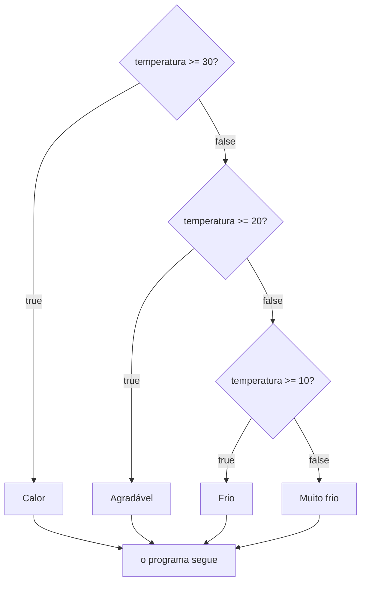

Terceira aula do módulo 3. Até aqui, as decisões tinham no máximo dois caminhos. O `if` sozinho faz ou não faz, e o `if`/`else` escolhe entre um e outro. A [[programacao/logica-de-programacao/modulo-3/02-if-else-o-outro-caminho|aula 3.2]] terminou com um caso que não cabia nisso: no "maior de dois", o empate não tinha onde ficar, porque a pergunta tem três respostas.

Muita pergunta do dia a dia tem três, quatro ou mais respostas: o tempo lá fora, o conceito de uma prova, a faixa de idade, o valor do frete. Para elas, o JavaScript permite encadear condições com `else if`, "senão, se".

## Senão, se...

```js
const temperatura = 24;

if (temperatura >= 30) {
  console.log("Calor");
} else if (temperatura >= 20) {
  console.log("Agradável");
} else if (temperatura >= 10) {
  console.log("Frio");
} else {
  console.log("Muito frio");
}

// saída: Agradável
```

Em português: "se fizer 30 graus ou mais, está calor. **Senão, se** fizer 20 ou mais, está agradável. **Senão, se** fizer 10 ou mais, está frio. **Senão**, está muito frio."

O JavaScript desce as perguntas de cima para baixo, como uma escada, e para no primeiro degrau que der `true`:

| Degrau | Pergunta, com 24 graus | Resposta | O que acontece |
|---|---|---|---|
| 1 | `24 >= 30` | `false` | desce para o próximo |
| 2 | `24 >= 20` | `true` | mostra `Agradável` e sai da escada |
| 3 | `24 >= 10` | | nem é perguntado |
| `else` | | | nem chega lá |

O terceiro degrau também daria `true`, mas não chega a ser testado. Quem diz "sim" primeiro fica com o valor, e o resto da escada é pulado. Pode haver quantos `else if` forem necessários entre o `if` e o `else`.



No [[glossario/fluxograma|fluxograma]], cada "não" leva ao losango seguinte, e cada "sim" sai direto para o fim.

## O `else if` não é uma palavra nova

Em uma frase: o JavaScript não obriga as chaves quando há **uma instrução só**, e o `else if` se aproveita disso. Ele não é um comando novo, e sim um `if` **aninhado** no `else`, quer dizer, posto dentro dele, só que escrito sem as chaves.

Dá para chegar nele em três passos, só com o que as aulas 3.1 e 3.2 já mostraram. Para ficar curto, o exemplo tem três caminhos: calor, agradável e frio.

**Passo 1: um `if` dentro do `else`.** Dentro do bloco do `else` pode ir qualquer instrução, e isso inclui outro `if` com outro `else`:

```js
if (temperatura >= 30) {
  console.log("Calor");
} else {
  if (temperatura >= 20) {
    console.log("Agradável");
  } else {
    console.log("Frio");
  }
}
```

Lê-se assim: "se fizer 30 ou mais, calor. Senão, faça isto: *se fizer 20 ou mais, agradável; senão, frio*". Isso já funciona, e não tem nada de novo.

**Passo 2: tirar as chaves do `else` de fora.** Repare no que ficou entre essas chaves: uma coisa só, o `if`/`else` de dentro. Um `if` com o seu `else` conta como **uma** instrução, mesmo ocupando várias linhas. E as chaves servem para juntar **várias** instruções num [[glossario/bloco|bloco]]. Com uma só lá dentro, dá para tirar:

```js
if (temperatura >= 30) {
  console.log("Calor");
} else
  if (temperatura >= 20) {
    console.log("Agradável");
  } else {
    console.log("Frio");
  }
```

**Passo 3: subir o `if` para a linha do `else`.** A quebra de linha e o recuo aqui não mudam nada para o JavaScript. Então dá para puxar o `if` para cima e alinhar tudo:

```js
if (temperatura >= 30) {
  console.log("Calor");
} else if (temperatura >= 20) {
  console.log("Agradável");
} else {
  console.log("Frio");
}
```

Pronto: é o `else if`. Os três códigos rodam igual, e o último é só o primeiro escrito de um jeito mais curto.

### Por que escrever assim

Com três caminhos, o código do passo 1 ainda se lê bem. Mas cada caminho a mais põe um `if` dentro de mais um `else`, e o código vai andando para a direita. O `else if` deixa tudo na mesma margem, com quantos caminhos forem.

> [!example]- A escada torta, com quatro caminhos (clique para abrir)
> O termômetro do começo da aula, escrito à moda do passo 1:
>
> ```js
> if (temperatura >= 30) {
>   console.log("Calor");
> } else {
>   if (temperatura >= 20) {
>     console.log("Agradável");
>   } else {
>     if (temperatura >= 10) {
>       console.log("Frio");
>     } else {
>       console.log("Muito frio");
>     }
>   }
> }
> ```
>
> Com dez caminhos, seriam dez níveis de recuo.

### E as chaves que saíram?

A aula 3.1 recomendou chaves sempre. O perigo, lá, era uma segunda linha que **parece** estar dentro do `if`, mas não está. Aqui isso não acontece: o que vem depois do `else` é um `if` inteiro, com as chaves dele. Não sobra linha solta. É o único caso em que o costume dispensa as chaves do `else`.

### Por que `elseif` dá erro

O `else if` são duas [[glossario/palavra-reservada|palavras reservadas]], uma depois da outra. Grudadas, viram `elseif`, uma palavra que o JavaScript não conhece. Ele a trata como um nome qualquer, como o de uma variável, e aí o `{` que vem depois não faz sentido:

```js
if (nota >= 9) {
  console.log("A");
} elseif (nota >= 7) {   // SyntaxError: Unexpected token '{'
  console.log("B");
}
```

## A ordem é parte da lógica

Como o primeiro "sim" leva tudo, a ordem das perguntas muda a resposta. Veja a mesma escada, de baixo para cima:

```js
const temperatura = 35;

if (temperatura >= 10) {
  console.log("Frio");
} else if (temperatura >= 20) {
  console.log("Agradável");
} else if (temperatura >= 30) {
  console.log("Calor");
} else {
  console.log("Muito frio");
}

// saída: Frio
```

São 35 graus, e o programa diz "Frio". As perguntas estão certas uma a uma, mas o `>= 10` vem primeiro e fica com tudo o que passa de 10, o que inclui o 20, o 30 e o 35. O "Agradável" e o "Calor" **nunca** aparecem, para temperatura nenhuma: são degraus mortos, código que existe mas não roda nunca. E o JavaScript não avisa nada.

A regra prática:

- **Com `>=` ou `>`**, comece pelo valor **maior** e desça: 30, 20, 10.
- **Com `<` ou `<=`**, comece pelo **menor** e suba. É o jeito da faixa de idade:

```js
const idade = 15;

if (idade < 13) {
  console.log("Criança");
} else if (idade < 18) {
  console.log("Adolescente");
} else if (idade < 60) {
  console.log("Adulto");
} else {
  console.log("Idoso");
}

// saída: Adolescente
```

Nos dois casos, a ideia é a mesma: a pergunta mais **apertada**, aquela em que cabem menos valores, vem antes. A mais larga vai para o fim, e o `else` pega o que sobrou.

## Cada degrau já sabe o "não" dos de cima

Quando o JavaScript chega ao `else if (temperatura >= 20)`, ele já sabe que a temperatura é menor que 30. Se não fosse, teria parado no degrau de cima. Por isso não é preciso escrever:

```js
} else if (temperatura >= 20 && temperatura < 30) {
```

O `temperatura < 30` sempre dá `true` ali, então não acrescenta nada. Cada degrau herda o "não" de todos os que vêm antes. A faixa "de 20 a 29,9" fica implícita.

Isso parece só economia, mas evita um erro. A aula descreve os conceitos de uma prova por faixas: de 9 a 10 é A, de 7 a 8,9 é B, de 5 a 6,9 é C e abaixo de 5 é D. Escrevendo as faixas ao pé da letra, aparecem buracos:

```js
const nota = 8.95;

if (nota >= 9) {
  console.log("Conceito A");
} else if (nota >= 7 && nota <= 8.9) {
  console.log("Conceito B");
} else if (nota >= 5 && nota <= 6.9) {
  console.log("Conceito C");
} else if (nota < 5) {
  console.log("Conceito D");
}

// saída: (nada)
```

O 8,95 não é maior ou igual a 9, nem menor ou igual a 8,9. Ele passa por todas as perguntas, cai num buraco entre duas faixas, e o programa não mostra nada. Na escada simples, `nota >= 9`, `nota >= 7`, `nota >= 5` e depois `else`, isso não acontece. Toda nota tem exatamente um lugar, sem buraco e sem sobra.

> [!tip] Teste as bordas
> Para conferir uma escada, não basta um valor do meio de cada faixa. Teste cada **limite** e um valor logo abaixo dele: 30 e 29,9; 20 e 19,9; 10 e 9,9. É nas bordas que se escondem os enganos entre `>=` e `>`, e os buracos.

## Quantos blocos rodam

A conta da aula 3.2, agora com a escada:

| Forma | Blocos que rodam |
|---|---|
| só `if` | nenhum ou 1 |
| `if` + `else` | sempre 1 |
| `if` + `else if` + `else if`... | nenhum ou 1 |
| `if` + `else if`... + `else` | sempre 1 |

Nunca mais de um. O `else` do fim é o "nenhuma das anteriores": a rede que pega o que passou por todos os degraus. Sem ele, um valor que não se encaixa em nada passa em silêncio, como o 8,95 acima.

Com `if`s separados, é diferente. Cada um pergunta por conta própria, e vários podem rodar:

```js
const nota = 9.5;

if (nota >= 9) {
  console.log("Conceito A");
}
if (nota >= 7) {
  console.log("Conceito B");
}
if (nota >= 5) {
  console.log("Conceito C");
}

// saída:
// Conceito A
// Conceito B
// Conceito C
```

A mesma nota recebe três conceitos. Os `if`s separados perguntam todos. O `else if` para no primeiro "sim".

## O empate da aula 3.2

Com três respostas, três caminhos:

```js
const a = 10;
const b = 10;

if (a > b) {
  console.log(a + " é o maior");
} else if (b > a) {
  console.log(b + " é o maior");
} else {
  console.log("Empate");
}

// saída: Empate
```

O `else` não precisa perguntar `a === b`. Se nenhum dos dois é maior, só sobra o empate.

> [!info] E o `switch`?
> Quando todas as perguntas comparam **a mesma variável** com valores exatos, como "é 1? é 2? é 3?", existe outra forma, o `switch`, da aula 3.5. Para faixas, com `>=` e `<`, o caminho é o `else if`.

## Lógica ou JavaScript?

| | JavaScript | Python | Pseudocódigo | Planilha (Excel) |
|---|---|---|---|---|
| senão, se | `} else if (...) {` | `elif ...:` | `SENAO SE` | um `SE` dentro do outro |

O Python tem uma palavra própria, `elif`, que junta *else* e *if*. A documentação do Python explica o motivo: evitar recuo demais. No Python, o recuo é o bloco, então um `else` com um `if` dentro teria de andar para a direita a cada degrau, como a escada torta lá de cima. O `elif` deixa tudo na mesma margem:

```python
if temperatura >= 30:
    print("Calor")
elif temperatura >= 20:
    print("Agradável")
elif temperatura >= 10:
    print("Frio")
else:
    print("Muito frio")
```

No pseudocódigo:

```text
SE temperatura >= 30 ENTAO
  ESCREVER "Calor"
SENAO SE temperatura >= 20 ENTAO
  ESCREVER "Agradável"
SENAO SE temperatura >= 10 ENTAO
  ESCREVER "Frio"
SENAO
  ESCREVER "Muito frio"
FIMSE
```

E na planilha, o encaixe fica à vista. Cada `SE` novo entra no lugar do "valor se falso" do anterior, como o `if` que entra no `else`:

```text
=SE(A1>=30; "Calor"; SE(A1>=20; "Agradável"; SE(A1>=10; "Frio"; "Muito frio")))
```

## Treine

> [!question] O que aparece no console, com a escada do termômetro?
> 1. `temperatura = 30`
> 2. `temperatura = 9.9`
> 3. Na faixa de idade, com `idade = 13` e com `idade = 60`.
> 4. Esta escada tem um problema. O que aparece com `idade = 8`? Como consertar?
>
> ```js
> if (idade < 60) {
>   console.log("Adulto");
> } else if (idade < 18) {
>   console.log("Adolescente");
> } else if (idade < 13) {
>   console.log("Criança");
> } else {
>   console.log("Idoso");
> }
> ```
>
> 5. Com `pontos = 120`, quantas mensagens aparecem? Reescreva para aparecer só uma, a certa.
>
> ```js
> if (pontos >= 100) { console.log("Ouro"); }
> if (pontos >= 50) { console.log("Prata"); }
> if (pontos >= 0) { console.log("Bronze"); }
> ```
>
> 6. O que sobra nesta condição? `if (nota >= 9) { ... } else if (nota >= 7 && nota < 9) { ... }`
> 7. Escreva o frete: compras de R$ 200 ou mais têm frete grátis, de R$ 100 ou mais pagam R$ 10, e as outras pagam R$ 20.
> 8. Para testar o item 7, que valores de compra você usaria?

> [!success]- Respostas (clique para abrir)
> 1. `Calor`: `30 >= 30` é `true`, porque o `>=` inclui o próprio 30.
> 2. `Muito frio`: 9,9 não passa em nenhum degrau, e cai no `else`.
> 3. Com 13, `Adolescente`: `13 < 13` é `false`, e `13 < 18` é `true`. Com 60, `Idoso`: `60 < 60` é `false`, e o 60 cai no `else`.
> 4. Aparece `Adulto`. O `idade < 60` vem primeiro e pega todo mundo abaixo de 60, crianças e adolescentes inclusive. Os degraus do "Adolescente" e da "Criança" nunca rodam. Com `<`, a ordem é do menor para o maior: `idade < 13`, depois `idade < 18`, depois `idade < 60`, e o `else` para o "Idoso".
> 5. Três: `Ouro`, `Prata` e `Bronze`, porque cada `if` pergunta sozinho. Com a escada, só `Ouro`:
>
> ```js
> if (pontos >= 100) {
>   console.log("Ouro");
> } else if (pontos >= 50) {
>   console.log("Prata");
> } else {
>   console.log("Bronze");
> }
> ```
>
> 6. O `nota < 9`. Para chegar ao `else if`, a nota já não passou no `nota >= 9`, então é menor que 9 com certeza. Basta `else if (nota >= 7)`.
> 7. Uma resposta possível:
>
> ```js
> if (compra >= 200) {
>   console.log("Frete grátis");
> } else if (compra >= 100) {
>   console.log("Frete: R$ 10");
> } else {
>   console.log("Frete: R$ 20");
> }
> ```
>
> 8. As bordas: 200 e 199,99, 100 e 99,99. E um valor bem acima, como 250, para garantir que o maior caso também funciona.

## De onde vêm as palavras

- **[[glossario/senao-se|Encadear]]**: de *cadeia*, do latim *catēna*, "corrente". Encadear é pôr em cadeia, ligar um elo no outro, como cada `else if` se liga ao anterior. Da mesma *catēna* vêm **concatenar**, que é juntar textos na programação (ver [[glossario/string|string]]), e o inglês **chain**, "corrente", que veio pelo francês antigo *chaeine*.
- **Escada** e **escala**: as duas vêm do latim *scāla*, "escada de mão" e, no plural, "escadaria". *Escada* chegou pela fala, pelo latim vulgar *\*scālāta*. *Escala* foi tirada do latim mais tarde, direto dos livros. É a escala do termômetro: os risquinhos, um acima do outro, são uma escada de números.
- **Degrau** e **grau**: as duas vêm do latim *gradus*, que queria dizer passo, degrau e também grau. *Degrau* veio do latim vulgar *\*dēgradus*. Os graus do termômetro são, ao pé da letra, os degraus da escala, e a escada de `else if` do termômetro sobe e desce em graus.
- **Aninhado**: de *aninhar*, que é *a-* + *ninho* + *-ar*: pôr no ninho. *Ninho* vem do latim *nīdus*, de uma raiz indo-europeia, *\*nisdós*, que juntava *\*ní*, "para baixo", e *\*sed-*, "sentar". O ninho era, ao pé da letra, **onde a ave se senta**. O inglês *nest*, de onde vem o *nested* ("aninhado") dos programadores, vem da mesma raiz. As duas línguas usam a mesma imagem, um `if` acomodado dentro do outro, com palavras da mesma origem.
- **Ordem**: do latim *ōrdō*, *ōrdinis*, "fileira, série, arrumação". Em latim, a ordem era também uma **fila**: coisas postas uma atrás da outra. É o que a escada de `else if` é, e por isso a ordem dela muda a resposta. Da mesma família vêm **ordenar** e **ordinal**, como em primeiro, segundo e terceiro, e mais adiante a **ordenação**, da aula 7.3.

> [!tip] Para guardar
> - `if`, depois quantos `else if` forem necessários, e por fim um `else`, se quiser. O JavaScript desce de cima para baixo e para no **primeiro** `true`. Os de baixo nem são testados.
> - Roda no máximo um bloco. Com o `else` no fim, roda sempre exatamente um.
> - A ordem é parte da lógica. Com `>=`, do maior para o menor. Com `<`, do menor para o maior. Fora de ordem, há degraus que nunca rodam, e o JavaScript não avisa.
> - Cada degrau já sabe o "não" dos de cima. Não repita a faixa com `&&`, porque é por aí que aparecem os buracos.
> - O `else if` é um `if` aninhado no `else`, sem as chaves: o JavaScript não obriga chaves quando há uma instrução só. Não existe `elseif`.
> - Teste as bordas de cada faixa.

Fontes: MDN: [if...else](https://developer.mozilla.org/en-US/docs/Web/JavaScript/Reference/Statements/if...else) · Python: [Tutorial, if Statements](https://docs.python.org/3/tutorial/controlflow.html#if-statements) · Wiktionary: [cadeia](https://en.wiktionary.org/wiki/cadeia), [concatenate](https://en.wiktionary.org/wiki/concatenate), [chain](https://en.wiktionary.org/wiki/chain), [escada](https://en.wiktionary.org/wiki/escada), [escala](https://en.wiktionary.org/wiki/escala), [scala](https://en.wiktionary.org/wiki/scala), [degrau](https://en.wiktionary.org/wiki/degrau), [grau](https://en.wiktionary.org/wiki/grau), [gradus](https://en.wiktionary.org/wiki/gradus), [ordem](https://en.wiktionary.org/wiki/ordem), [ordo](https://en.wiktionary.org/wiki/ordo), [aninhar](https://en.wiktionary.org/wiki/aninhar), [ninho](https://en.wiktionary.org/wiki/ninho), [nidus](https://en.wiktionary.org/wiki/nidus), [nest](https://en.wiktionary.org/wiki/nest), [\*nisdós](https://en.wiktionary.org/wiki/Reconstruction:Proto-Indo-European/nisd%C3%B3s)
