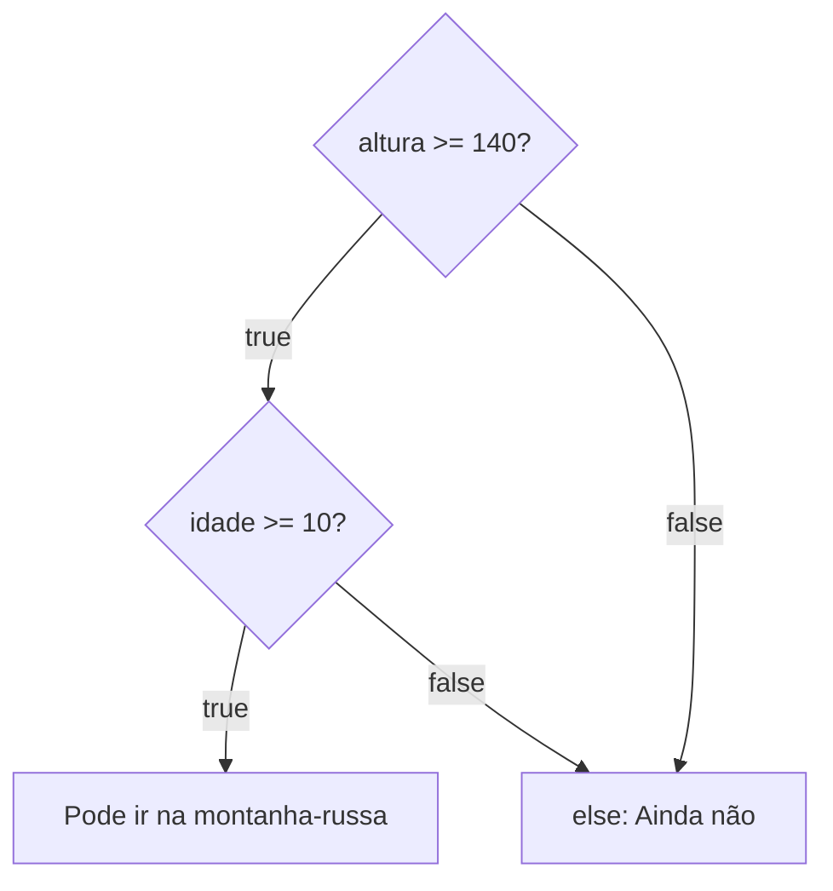

Quarta aula do módulo 3. Até aqui, quase todo `if` fazia uma pergunta só: "tem saldo?", "faz calor?". Mas muita decisão depende de duas ou mais coisas ao mesmo tempo. Os operadores que juntam perguntas já apareceram na [[programacao/logica-de-programacao/modulo-2/05-operadores-logicos|aula 2.5]]: `&&` (e), `||` (ou) e `!` (não). Lá, o resultado ia para um `console.log` ou para uma variável. Agora ele vai para dentro do `if`.

Não tem sintaxe nova. A aula 3.1 disse que nos parênteses do `if` vai qualquer coisa que dê `true` ou `false`, e é exatamente isso que o `&&`, o `||` e o `!` devolvem. Uma condição feita de várias perguntas se chama **[[glossario/condicao-composta|condição composta]]**.

| Operador | Lê-se | O bloco do `if` roda quando |
|---|---|---|
| `&&` | e | **todas** as perguntas dão `true` |
| `\|\|` | ou | **pelo menos uma** dá `true` |
| `!` | não | a pergunta dá `false` |

A [[glossario/tabela-verdade|tabela-verdade]] completa está na aula 2.5.

## No parque de diversões

**E: as duas coisas.** Na montanha-russa, só entra quem tem pelo menos 1,40 m **e** pelo menos 10 anos:

```js
const altura = 145; // em centímetros
const idade = 9;

if (altura >= 140 && idade >= 10) {
  console.log("Pode ir na montanha-russa");
} else {
  console.log("Ainda não");
}

// saída: Ainda não
```

A altura dava, mas a idade não. Com o `&&`, uma resposta `false` basta para barrar.

**Ou: uma já basta.** A entrada do parque é grátis para menores de 5 anos **ou** para quem faz aniversário no dia:

```js
const idade = 30;
const fazAniversarioHoje = true;

if (idade < 5 || fazAniversarioHoje) {
  console.log("Entrada grátis");
} else {
  console.log("Entrada paga");
}

// saída: Entrada grátis
```

Trinta anos não é menos que 5, mas é aniversário, e isso basta.

**Não: o contrário.** Os brinquedos aquáticos só abrem se **não** estiver chovendo:

```js
const chovendo = false;

if (!chovendo) {
  console.log("Brinquedos aquáticos abertos");
}

// saída: Brinquedos aquáticos abertos
```

É um caminho só, e ele é o do "não", o caso em que o `!` cabe bem, como na aula 3.2.

## Um `&&` é um `if` dentro de outro

O `&&` faz o mesmo que dois `if`s, um dentro do outro:

```js
if (altura >= 140) {
  if (idade >= 10) {
    console.log("Pode ir na montanha-russa");
  }
}
```

Para chegar à mensagem, é preciso passar pelas duas portas: primeiro a da altura, depois a da idade. O `&&` junta as duas portas numa linha só, como o `else if` da [[programacao/logica-de-programacao/modulo-3/03-else-if-varias-condicoes-em-cadeia|aula 3.3]] deixava reta uma escada de `if`s.



Repare no `else` do desenho: chegam até ele **duas** setas. Isso explica a próxima seção.

## Quem cai no `else`?

No `if (altura >= 140 && idade >= 10)`, o `else` recebe quem falhou em **pelo menos uma** das perguntas: quem é baixo demais, quem é novo demais, ou os dois. Ou seja, o `else` de um "e" é um "ou":

| Condição do `if` | Quem cai no `else` |
|---|---|
| `altura >= 140 && idade >= 10` | `altura < 140 \|\| idade < 10` |

É a regra de De Morgan, que a aula 2.5 mostrou numa caixa recolhida: negar um "e" dá um "ou" com as perguntas invertidas. Aqui ela aparece na prática.

O problema é que o `else` não sabe **qual** pergunta falhou. Para a criança de 1,45 m e 9 anos, "Ainda não" é pouco. Se a mensagem precisa dizer o motivo, a escada da aula 3.3 resolve:

```js
const altura = 145;
const idade = 9;

if (altura >= 140 && idade >= 10) {
  console.log("Pode ir na montanha-russa");
} else if (altura < 140) {
  console.log("Precisa ter pelo menos 1,40 m");
} else {
  console.log("Precisa ter pelo menos 10 anos");
}

// saída: Precisa ter pelo menos 10 anos
```

O último `else` nem precisa perguntar pela idade. Ele usa a ideia da aula 3.3, de que cada degrau já sabe o "não" dos de cima:

1. Se chegou ao `else`, as duas coisas juntas não valiam.
2. Também não era a altura, senão teria parado no `else if`.
3. Então só pode ser a idade.

Com uma criança baixa **e** nova, aparece só o primeiro motivo, o da altura. Para mostrar os dois, seriam precisos dois `if`s separados.

## O maior de três

Um número é o maior de três quando é maior ou igual a cada um dos outros dois, **ao mesmo tempo**. Isso é um `&&`:

```js
const a = 4;
const b = 15;
const c = 9;

if (a >= b && a >= c) {
  console.log(a + " é o maior");
} else if (b >= a && b >= c) {
  console.log(b + " é o maior");
} else {
  console.log(c + " é o maior");
}

// saída: 15 é o maior
```

O `else` do fim não pergunta nada sobre o `c`. Se nem o `a` nem o `b` são o maior, só sobra ele.

**Por que `>=`, e não `>`?** Teste uma borda, como na aula 3.3: um empate. Com `a = 15`, `b = 15` e `c = 9`, e com `>` no lugar de `>=`:

| Pergunta | Resposta |
|---|---|
| `a > b && a > c` → `15 > 15 && 15 > 9` | `false`, porque 15 não é maior que 15 |
| `b > a && b > c` → `15 > 15 && 15 > 9` | `false`, pelo mesmo motivo |
| `else` | mostra `9 é o maior` |

O programa diz que o 9 é o maior, justamente o menor dos três. Com `>=`, o empate passa no primeiro degrau, e aparece "15 é o maior", que está certo.

## Três armadilhas do português

Em português, a gente corta palavras repetidas: "se a idade for maior que 18 **e** menor que 60", "se o dia for sábado **ou** domingo". O JavaScript não corta. Cada lado do `&&` e do `||` precisa ser uma **pergunta completa**.

**1. Faltou o nome do lado direito.**

```js
if (idade >= 18 && <= 60) {   // SyntaxError: Unexpected token '<='
```

Depois do `&&`, o JavaScript espera uma pergunta nova, e `<= 60` não diz **quem** é menor ou igual a 60. Pelo menos dá erro, e você vê na hora. O certo é repetir a variável: `idade >= 18 && idade <= 60`.

**2. O jeito da matemática.** Na escola, escreve-se 18 ≤ idade ≤ 60. Em JavaScript, isso não dá erro, mas está errado:

```js
const idade = 70;

if (18 <= idade <= 60) {
  console.log("Está entre 18 e 60");
}

// saída: Está entre 18 e 60   (70 não está!)
```

O JavaScript resolve da esquerda para a direita, em dois passos:

1. `18 <= 70` dá `true`.
2. Sobra `true <= 60`. Para comparar com um número, o `true` vira 1, e `1 <= 60` dá `true`.

Com qualquer idade, o primeiro passo dá `true` ou `false`, que viram 1 ou 0, e os dois são menores que 60. O bloco roda **sempre**. O certo, de novo, é `idade >= 18 && idade <= 60`.

**3. O "ou" com um valor solto.**

```js
const dia = "terça";

if (dia === "sábado" || "domingo") {
  console.log("Fim de semana");
}

// saída: Fim de semana   (numa terça!)
```

O lado direito do `||` é só o texto `"domingo"`, e não a pergunta "o dia é domingo?". Um texto que não está vazio conta como verdadeiro, o *truthy* da aula 3.1. Então o `||` sempre encontra um lado verdadeiro, e o bloco roda todo dia. O certo é `dia === "sábado" || dia === "domingo"`.

| Em português | Errado | Certo |
|---|---|---|
| idade entre 18 e 60 | `idade >= 18 && <= 60` | `idade >= 18 && idade <= 60` |
| idade entre 18 e 60 | `18 <= idade <= 60` | `idade >= 18 && idade <= 60` |
| sábado ou domingo | `dia === "sábado" \|\| "domingo"` | `dia === "sábado" \|\| dia === "domingo"` |

As armadilhas 2 e 3 são as piores, porque o programa roda sem reclamar e só dá a resposta errada.

## Misturou `&&` com `||`? Parênteses

A aula 2.5 mostrou que o `&&` é resolvido antes do `||`. Dentro de um `if`, isso decide quem entra. Pense numa meia-entrada para estudantes ou idosos, mas só com documento:

```js
const ehEstudante = true;
const ehIdoso = false;
const temDocumento = false;

if (ehEstudante || ehIdoso && temDocumento) {
  console.log("Meia-entrada");
}

// saída: Meia-entrada   (sem documento!)
```

Como o `&&` vai antes, o JavaScript leu `ehEstudante || (ehIdoso && temDocumento)`: o documento só foi exigido do idoso. O estudante passou sem mostrar nada. Com parênteses, a regra fica a que se quis:

```js
if ((ehEstudante || ehIdoso) && temDocumento) {
  console.log("Meia-entrada");
} else {
  console.log("Inteira");
}

// saída: Inteira
```

## Dê nome à condição

Quando a condição cresce, ela fica difícil de ler dentro dos parênteses do `if`. Uma saída é guardar cada parte numa variável com nome de pergunta, como na aula 2.4:

```js
const temAltura = altura >= 140;
const temIdade = idade >= 10;
const podeIr = temAltura && temIdade;

if (podeIr) {
  console.log("Pode ir na montanha-russa");
}
```

O `if (podeIr)` se lê como português: "se pode ir". É a divisão da aula 3.1, em que o `&&` **responde** e o `if` **age**: as variáveis montam a resposta, e o `if` só usa.

## O `!` com `else`

A aula do curso usa este exemplo:

```js
const bloqueado = false;

if (!bloqueado) {
  console.log("Acesso liberado");
} else {
  console.log("Acesso negado");
}
```

Funciona. Mas lembre da [[programacao/logica-de-programacao/modulo-3/02-if-else-o-outro-caminho|aula 3.2]]: com dois caminhos, o `else` de um `!` vira negação dupla ("se não for verdade que não está bloqueado"). Com a condição sem `!`, cada bloco fica no seu lugar:

```js
if (bloqueado) {
  console.log("Acesso negado");
} else {
  console.log("Acesso liberado");
}
```

## Lógica ou JavaScript?

A tabela com os símbolos de cada linguagem está na aula 2.5: o Python escreve `and`, `or` e `not`, e a planilha usa `E()`, `OU()` e `NÃO()`. Uma diferença vale a pena aqui. A armadilha 2, `18 <= idade <= 60`, **funciona** no Python:

```python
idade = 70
print(18 <= idade <= 60)   # False
```

O Python entende comparações em sequência como na matemática: `a < b <= c` quer dizer `a < b and b <= c`. O JavaScript não entende assim. Por isso, quem vem do Python cai nessa armadilha com facilidade.

Na planilha, a montanha-russa fica assim:

```text
=SE(E(A1>=140; B1>=10); "Pode ir"; "Ainda não")
```

## Treine

Tente responder antes de abrir a resposta, logo abaixo de cada pergunta.

> [!question] 1. O que aparece no console?
> ```js
> const altura = 150;
> const idade = 12;
>
> if (altura >= 140 && idade >= 10) {
>   console.log("Pode ir");
> } else {
>   console.log("Ainda não");
> }
> ```
>
> > [!success]- Resposta
> > `Pode ir`: `150 >= 140` e `12 >= 10` dão `true`, e o `&&` recebe dois `true`.

> [!question] 2. O que aparece no console?
> ```js
> const idade = 3;
> const fazAniversarioHoje = false;
>
> if (idade < 5 || fazAniversarioHoje) {
>   console.log("Entrada grátis");
> } else {
>   console.log("Entrada paga");
> }
> ```
>
> > [!success]- Resposta
> > `Entrada grátis`: `3 < 5` dá `true`, e para o `||` isso basta.

> [!question] 3. Este código dá erro. Por quê? Como consertar?
> ```js
> const nota = 6;
>
> if (nota >= 5 && < 7) {
>   console.log("Recuperação");
> }
> ```
>
> > [!success]- Resposta
> > Depois do `&&` falta dizer **quem** é menor que 7. O JavaScript mostra `SyntaxError: Unexpected token '<'`. O certo é `if (nota >= 5 && nota < 7)`.

> [!question] 4. Este código mostra "Fim de semana" numa terça. Por quê? Como consertar?
> ```js
> const dia = "terça";
>
> if (dia === "sábado" || "domingo") {
>   console.log("Fim de semana");
> }
> ```
>
> > [!success]- Resposta
> > O lado direito do `||` é só o texto `"domingo"`, que conta como verdadeiro por não estar vazio. Então o `||` sempre dá verdadeiro. O certo é `if (dia === "sábado" || dia === "domingo")`.

> [!question] 5. O que aparece no console? A resposta está certa?
> ```js
> const a = 7;
> const b = 7;
> const c = 3;
>
> if (a > b && a > c) {
>   console.log(a + " é o maior");
> } else if (b > a && b > c) {
>   console.log(b + " é o maior");
> } else {
>   console.log(c + " é o maior");
> }
> ```
>
> > [!success]- Resposta
> > Aparece `3 é o maior`, e está errado. Com o empate, `7 > 7` dá `false` nas duas primeiras perguntas, e o `else` fica com o menor número. Trocando `>` por `>=`, aparece `7 é o maior`.

> [!question] 6. Escreva o `if`
> Um cinema dá meia-entrada para estudantes ou para quem tem 60 anos ou mais, sempre com documento. Escreva o `if`, com as variáveis `ehEstudante`, `idade` e `temDocumento`. Ele deve mostrar "Meia-entrada" ou "Inteira".
>
> > [!success]- Resposta
> > Os parênteses são o ponto principal. Sem eles, o documento só seria exigido de quem tem 60 anos ou mais.
> >
> > ```js
> > if ((ehEstudante || idade >= 60) && temDocumento) {
> >   console.log("Meia-entrada");
> > } else {
> >   console.log("Inteira");
> > }
> > ```

> [!question] 7. Reescreva sem o `!`, trocando os blocos de lugar
> ```js
> if (!estaLogado) {
>   console.log("Faça login");
> } else {
>   console.log("Bem-vindo!");
> }
> ```
>
> > [!success]- Resposta
> > Os blocos trocam de lugar junto com a condição:
> >
> > ```js
> > if (estaLogado) {
> >   console.log("Bem-vindo!");
> > } else {
> >   console.log("Faça login");
> > }
> > ```

> [!question] 8. Quem cai no `else`?
> Responda em português e depois com uma condição em JavaScript.
>
> ```js
> if (temIngresso && idade >= 18) {
>   console.log("Pode entrar");
> } else {
>   console.log("Não pode entrar");
> }
> ```
>
> > [!success]- Resposta
> > Quem não tem ingresso, ou quem tem menos de 18 anos, ou as duas coisas. Em JavaScript: `!temIngresso || idade < 18`. O `else` de um "e" é um "ou", com cada pergunta invertida.

## De onde vêm as palavras

- **[[glossario/condicao-composta|Composto]]**: do latim *compostus*, uma forma encurtada de *compositus*. É o particípio de *compōnere*, que é *con-* ("junto") + *pōnere* ("pôr"), e queria dizer arrumar, montar, compor. Em português, *composto* é o particípio de **compor**. Uma condição composta é uma condição **posta junto**, montada com várias perguntas, como uma palavra composta é montada com outras palavras.
- **Montanha-russa**: o brinquedo descende de montes de gelo construídos na Rússia, sobretudo em volta de São Petersburgo, por onde as pessoas desciam de trenó no inverno. O nome em português lembra essa origem. Em russo, o nome popular é o contrário: *amerikanskie gorki*, algo como "montanha americana". Cada país batizou o brinquedo com o nome do outro.

> [!tip] Para guardar
> - Os parênteses do `if` aceitam condições compostas: `&&` exige todas as perguntas, `||` se contenta com uma, e `!` inverte.
> - Um `&&` é um `if` dentro de outro. O `else` de um "e" recebe quem falhou em pelo menos uma pergunta, mas não sabe qual. Para dizer o motivo, use `else if`.
> - Cada lado do `&&` e do `||` é uma pergunta completa: `idade >= 18 && idade <= 60`, e nunca `18 <= idade <= 60`. E `dia === "sábado" || dia === "domingo"`, nunca `dia === "sábado" || "domingo"`.
> - Misturou `&&` com `||`? Parênteses.
> - Condição comprida? Guarde as partes em variáveis com nome de pergunta.
> - Teste os empates e as bordas: no "maior de três", o `>` no lugar do `>=` erra justamente no empate.

Fontes: MDN: [Logical AND (&&)](https://developer.mozilla.org/en-US/docs/Web/JavaScript/Reference/Operators/Logical_AND), [Logical OR (\|\|)](https://developer.mozilla.org/en-US/docs/Web/JavaScript/Reference/Operators/Logical_OR), [Operator precedence](https://developer.mozilla.org/en-US/docs/Web/JavaScript/Reference/Operators/Operator_precedence) · Python: [Comparisons](https://docs.python.org/3/reference/expressions.html#comparisons) · Wiktionary: [composto](https://en.wiktionary.org/wiki/composto), [compono](https://en.wiktionary.org/wiki/compono) · Wikipedia: [Montanha-russa](https://pt.wikipedia.org/wiki/Montanha-russa)
