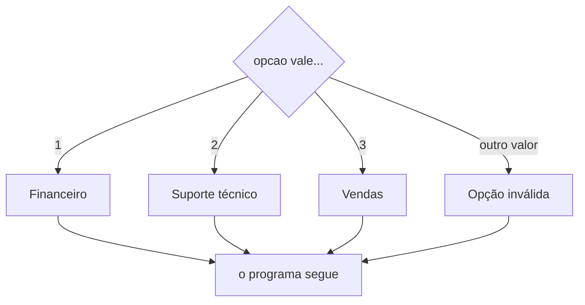

Quinta e última aula do módulo 3. O `if`, o `else` e o `else if` das aulas anteriores resolvem qualquer decisão. Esta aula mostra uma ferramenta mais especializada, o **[[glossario/escolha|switch]]**. Ele não faz nada que o `else if` não faça, mas, num tipo de pergunta bem específico, deixa o código mais curto e mais fácil de ler.

Para saber que tipo de pergunta é essa, primeiro é preciso separar duas coisas: **valor exato** e **faixa**.

## Valor exato ou faixa?

Pense no atendimento por telefone de uma empresa: "Para falar com o financeiro, digite 1. Para suporte técnico, digite 2. Para vendas, digite 3". As respostas possíveis são poucas e soltas: 1, 2 ou 3. Não existe "2 e meio". Cada número leva a um lugar. Isso é escolher por **valor exato**.

Agora pense no termômetro da [[programacao/logica-de-programacao/modulo-3/03-else-if-varias-condicoes-em-cadeia|aula 3.3]]. "Agradável" não é uma temperatura só: é tudo de 20 até antes de 30. Vale para 20, 21, 25,5, 29,9 e para todos os números no meio deles, que não acabam nunca. Um trecho assim, de um limite até outro, com tudo o que fica entre eles, é uma **[[glossario/faixa|faixa]]**.

A palavra é a mesma da faixa de pedestres: uma tira pintada no chão. Imagine os números enfileirados numa reta, como numa régua. A faixa é uma tira dessa régua:

```text
Valores exatos: pontos soltos
   1     2     3
   ●     ●     ●

Faixas: tiras inteiras da régua
   0          10          20          30
   ├──────────┼───────────┼───────────┼──────→
    muito frio    frio      agradável   calor
```

O mesmo vale para a **faixa etária**, que é uma tira de idades, como "de 13 a 17 anos", e para a faixa de preço, a faixa de notas, a faixa de velocidade.

Um teste ajuda a separar os dois:

> [!tip] Dá para listar, um por um?
> - **Dá**, e cada valor tem a sua resposta: dias da semana (1 a 7), opções de um menu, cores do semáforo. É **valor exato**.
> - **Não dá**, porque entre dois valores sempre cabe outro (20; 20,1; 20,01...): temperatura, preço, altura, nota. É **faixa**.
> - **Dá, mas a mesma resposta vale para um trecho inteiro**: a idade é um número inteiro, mas "criança" vale de 0 a 12. Listar treze idades para dar a mesma resposta não faz sentido. Na prática, também é **faixa**.

Em código, a diferença aparece no sinal:

| Tipo | Pergunta | Sinal |
|---|---|---|
| valor exato | "é igual a 3?" | `===` |
| faixa | "está de 20 até antes de 30?" | `>=`, `<`, `>` ou `<=` |

O `switch` só sabe fazer a primeira pergunta.

## O problema: muitos `===` repetidos

Com o `else if`, o atendimento fica assim:

```js
const opcao = 2;

if (opcao === 1) {
  console.log("Financeiro");
} else if (opcao === 2) {
  console.log("Suporte técnico");
} else if (opcao === 3) {
  console.log("Vendas");
} else {
  console.log("Opção inválida");
}

// saída: Suporte técnico
```

Funciona. Mas repare: toda linha repete `opcao ===`. Com três opções, ainda vai. Com os sete dias da semana, que é o exemplo da aula, são sete `dia ===`, e com os doze meses do ano, doze. A pergunta é sempre a mesma, "a opção é igual a quê?", e só o número muda.

## O `switch`

O `switch` faz a pergunta uma vez só e lista as respostas embaixo:

```js
const opcao = 2;

switch (opcao) {
  case 1:
    console.log("Financeiro");
    break;
  case 2:
    console.log("Suporte técnico");
    break;
  case 3:
    console.log("Vendas");
    break;
  default:
    console.log("Opção inválida");
}

// saída: Suporte técnico
```

As peças, uma por uma:

| Peça | Lê-se | O que faz |
|---|---|---|
| `switch (opcao)` | "olhe para a opção" | pega o valor que vai ser comparado, uma vez só |
| `case 1:` | "se for 1, comece aqui" | marca onde entrar quando o valor é igual a 1 |
| `break;` | "pare e saia" | pula para depois do `}` do `switch` |
| `default:` | "se nenhum bateu" | é o `else` do `switch` |

### Os dois-pontos do `case`

Até aqui, toda decisão usava parênteses e chaves: `if (condição) { ... }`. O `switch` traz um sinal novo: depois de cada `case`, e também do `default`, vem **dois-pontos**, e não chaves. As linhas do caso ficam recuadas embaixo dele, sem `{ }` em volta.

Os dois-pontos funcionam como no português, em que anunciam o que vem a seguir: "Opção 1: financeiro". Num cardápio, "Bebidas:" e "Sobremesas:" são títulos que marcam onde começa cada parte da lista. O `case 1:` é um título desses. Ele marca **onde começa** o caso 1 dentro do bloco do `switch`.

Por isso o sinal é diferente: as chaves de um `if` **fecham** um bloco, com começo e fim. Os dois-pontos só **marcam** um começo. O `switch` tem um bloco só, o das chaves de fora. Os `case` são marcações dentro dele, como os títulos de um cardápio. Nada nos dois-pontos diz onde o caso termina, e é por isso que o `break` é necessário (logo abaixo).

#### Sem chaves, mas com quantas linhas quiser

Não confunda com a regra da aula 3.1. Lá, um `if` sem chaves manda numa instrução só, porque o `if` **comanda** a instrução que vem depois dele. O `case` não comanda nada. Ele só marca um lugar, e por isso não tem limite de linhas:

```js
const opcao = 2;

switch (opcao) {
  case 1:
    console.log("Financeiro");
    break;
  case 2:
    console.log("Suporte técnico");
    console.log("Aguarde um atendente");
    console.log("Tempo de espera: 5 minutos");
    break;
  default:
    console.log("Opção inválida");
}

// saída:
// Suporte técnico
// Aguarde um atendente
// Tempo de espera: 5 minutos
```

O `switch` não escolhe um bloco. Ele escolhe um **ponto de partida** e pula para lá. Daí em diante, o código roda do jeito de sempre, de cima para baixo, linha por linha, até encontrar um `break` ou o `}` do fim do `switch`.

| | `if` sem chaves | `case` |
|---|---|---|
| quantas instruções pega | só a primeira | todas, até parar |
| onde para | logo depois da primeira instrução | no `break`, ou no `}` do `switch` |
| o que ele é | um comando: decide se a instrução roda | uma marcação: diz onde começar |

O jeito de escrever vem da linguagem C, de onde o JavaScript herdou também o `if` (aula 3.1).

Trocar os dois-pontos por ponto e vírgula dá erro: `case 1;` mostra `SyntaxError: Unexpected token ';'`.

> [!info]- E se eu puser chaves no `case`? (clique para abrir)
> O JavaScript aceita `case 1: { ... }`, mas as chaves não mudam nada no que importa. A marcação continua sendo o `case 1:`, e as chaves são só um bloco solto dentro dele, como os da aula 3.2. O `break` continua necessário:
>
> ```js
> const opcao = 1;
>
> switch (opcao) {
>   case 1: {
>     console.log("Financeiro");
>   }
>   case 2: {
>     console.log("Suporte técnico");
>   }
> }
>
> // saída:
> // Financeiro
> // Suporte técnico
> ```
>
> Mesmo com chaves, sem `break` a execução cai no caso de baixo.

### Passo a passo, com `opcao = 2`

| Passo | O JavaScript pergunta | Resposta | O que acontece |
|---|---|---|---|
| 1 | `2 === 1`? | não | pula para o próximo `case` |
| 2 | `2 === 2`? | sim | entra: mostra `Suporte técnico` |
| 3 | | | chega ao `break` e sai do `switch` |

O `case 3` e o `default` nem chegam a ser olhados.



Compare com a escada da aula 3.3, em que cada degrau era um losango novo, com uma pergunta nova. Aqui há **um** losango só, com várias saídas: uma pergunta, muitas respostas possíveis. É como a agulha de uma linha de trem, que manda o trem para um dos trilhos. O nome *switch* vem daí (veja no fim da aula).

## O `case` é uma porta de entrada

Este é o ponto que mais confunde no `switch`. O `case` **não** é uma caixa fechada, como o bloco de um `if`. Ele é só uma **porta de entrada**: diz onde começar. Quem diz onde parar é o `break`.

Pense numa linha de ônibus com paradas em sequência. O `case` é a parada onde você **sobe**. O `break` é o "desce aqui". Sem o `break`, você não desce: vai até o ponto final, passando por todas as paradas seguintes.

Veja o atendimento sem nenhum `break`:

```js
const opcao = 2;

switch (opcao) {
  case 1:
    console.log("Financeiro");
  case 2:
    console.log("Suporte técnico");
  case 3:
    console.log("Vendas");
  default:
    console.log("Opção inválida");
}

// saída:
// Suporte técnico
// Vendas
// Opção inválida
```

O JavaScript entrou pela porta do `case 2`, como devia. Depois, sem `break`, seguiu rodando tudo o que vinha embaixo: o `case 3` e até o `default`. Ele **não confere** mais os valores dos `case` seguintes, só segue descendo, linha por linha, até o fim.

Isso tem nome: ***fall-through***, em inglês "cair através", porque a execução cai de um caso para o outro. Quase sempre é um erro. Daí a regra prática: **todo `case` termina com `break`**. O último bloco, que costuma ser o `default`, não precisa, porque depois dele o `switch` acaba de qualquer jeito.

### Quando cair de propósito

Há um uso certo para o *fall-through*: dar a mesma resposta para vários valores. Basta empilhar os `case` sem nada entre eles:

```js
const dia = 7;

switch (dia) {
  case 1:
  case 7:
    console.log("Fim de semana");
    break;
  case 2:
  case 3:
  case 4:
  case 5:
  case 6:
    console.log("Dia útil");
    break;
  default:
    console.log("Dia inválido");
}

// saída: Fim de semana
```

Com `dia = 7`, o JavaScript entra pela porta do `case 7` e roda até o primeiro `break`. Com `dia = 1`, entra pela porta do `case 1`, que está vazia, cai no `case 7` e chega ao mesmo lugar. É o jeito do `switch` de dizer "1 **ou** 7", o `||` da [[programacao/logica-de-programacao/modulo-3/04-condicoes-compostas-e-ou-nao|aula 3.4]].

> [!warning] Não escreva `case 1 || 7:`
> Parece o jeito certo de dizer "1 ou 7", mas não é. O JavaScript calcula `1 || 7` antes, e isso dá `1`, porque o `||` devolve o primeiro lado verdadeiro. Sobra `case 1:`, e o 7 não entra. É parente da armadilha `dia === "sábado" || "domingo"` da aula 3.4. Para "isto ou aquilo" no `switch`, empilhe os `case`.

## O `switch` compara com `===`

Cada `case` pergunta "é **exatamente** igual?", com as mesmas regras do `===` da [[programacao/logica-de-programacao/modulo-2/04-comparacoes|aula 2.4]]. Duas consequências:

**1. Texto e número são diferentes.** Se a opção chegar como o texto `"2"`, e não como o número `2`, nenhum `case` bate:

```js
const opcao = "2";   // com aspas: é texto

switch (opcao) {
  case 1:
    console.log("Financeiro");
    break;
  case 2:
    console.log("Suporte técnico");
    break;
  default:
    console.log("Opção inválida");
}

// saída: Opção inválida
```

Para o `===`, o texto `"2"` e o número `2` são coisas diferentes, como na aula 2.2.

**2. Maiúscula conta.** O `switch` também funciona com textos, e isso é muito comum:

```js
const cor = "amarelo";

switch (cor) {
  case "vermelho":
    console.log("Pare");
    break;
  case "amarelo":
    console.log("Atenção");
    break;
  case "verde":
    console.log("Siga");
    break;
  default:
    console.log("Cor desconhecida");
}

// saída: Atenção
```

Mas com `cor = "Vermelho"`, com V maiúsculo, aparece "Cor desconhecida". `"Vermelho"` e `"vermelho"` não são iguais.

## Por que o `switch` não serve para faixas

Dá vontade de tentar:

```js
const temperatura = 35;

switch (temperatura) {
  case temperatura >= 30:
    console.log("Calor");
    break;
  case temperatura >= 20:
    console.log("Agradável");
    break;
  default:
    console.log("Nenhum case bateu");
}

// saída: Nenhum case bateu
```

Faz 35 graus, e o "Calor" não aparece. Por quê? O `case` não pergunta o que está escrito depois dele. Ele **calcula** o que está escrito, e depois compara o resultado com o valor do `switch`, usando `===`:

1. `temperatura >= 30` dá `true`.
2. O `case` vira `case true:`.
3. O JavaScript compara `35 === true`. Um número nunca é igual a um booleano, então dá `false`.

Nenhum `case` bate. O `switch` só sabe perguntar "é igual a?", e uma faixa precisa de "é maior que?" ou "é menor que?". Para faixas, o caminho é a escada de `else if` da aula 3.3.

## `switch` ou `else if`?

| A pergunta | Exemplo | Use |
|---|---|---|
| a mesma variável, comparada com vários valores exatos | dia da semana, opção do menu, cor do semáforo, mês | `switch` (o `else if` também resolve) |
| faixas | temperatura, nota, idade, preço | `else if` com `>=` e `<` |
| perguntas sobre variáveis diferentes | altura **e** idade | `else if`, com `&&` e `\|\|` |
| só dois caminhos | tem estoque ou não | `if`/`else` |

Tudo o que um `switch` faz, um `else if` também faz. O contrário não vale. O `switch` não é obrigatório: ele só lê melhor quando há muitos valores exatos para a mesma variável.

## Lógica ou JavaScript?

| | JavaScript | Python | Pseudocódigo | Planilha (Excel) |
|---|---|---|---|---|
| escolha | `switch` / `case` / `default` | `match` / `case` / `case _` | `ESCOLHA` / `CASO` / `OUTROCASO` | `ESCOLHER` |

O Python só ganhou o `match` na versão 3.10, de 2021. Antes, usava-se `if`/`elif`. E o `match` não tem `break` nem *fall-through*: só roda o primeiro caso que bate.

```python
opcao = 2

match opcao:
    case 1:
        print("Financeiro")
    case 2:
        print("Suporte técnico")
    case 3:
        print("Vendas")
    case _:
        print("Opção inválida")
```

O `_` é o "qualquer outra coisa", o `default` do Python.

No pseudocódigo:

```text
ESCOLHA opcao
  CASO 1
    ESCREVER "Financeiro"
  CASO 2
    ESCREVER "Suporte técnico"
  CASO 3
    ESCREVER "Vendas"
  OUTROCASO
    ESCREVER "Opção inválida"
FIMESCOLHA
```

Na planilha, a função `ESCOLHER` pega um valor de uma lista pela posição: com 1, devolve o primeiro, com 2, o segundo, e assim por diante. É perfeita para o dia da semana:

```text
=ESCOLHER(A1; "Domingo"; "Segunda-feira"; "Terça-feira"; "Quarta-feira"; "Quinta-feira"; "Sexta-feira"; "Sábado")
```

## Treine

Tente responder antes de abrir a resposta, logo abaixo de cada pergunta.

> [!question] 1. O que aparece no console?
> ```js
> const opcao = 3;
>
> switch (opcao) {
>   case 1:
>     console.log("Financeiro");
>     break;
>   case 2:
>     console.log("Suporte técnico");
>     break;
>   case 3:
>     console.log("Vendas");
>     break;
>   default:
>     console.log("Opção inválida");
> }
> ```
>
> > [!success]- Resposta
> > `Vendas`: o `case 1` e o `case 2` não batem, o `case 3` bate, e o `break` encerra o `switch` logo depois.

> [!question] 2. E se a pessoa digitar 9?
> ```js
> const opcao = 9;
>
> switch (opcao) {
>   case 1:
>     console.log("Financeiro");
>     break;
>   case 2:
>     console.log("Suporte técnico");
>     break;
>   case 3:
>     console.log("Vendas");
>     break;
>   default:
>     console.log("Opção inválida");
> }
> ```
>
> > [!success]- Resposta
> > `Opção inválida`: nenhum `case` bate, e quem fica com o resto é o `default`.

> [!question] 3. O que aparece no console? Repare que não há nenhum `break`
> ```js
> const opcao = 1;
>
> switch (opcao) {
>   case 1:
>     console.log("Financeiro");
>   case 2:
>     console.log("Suporte técnico");
>   case 3:
>     console.log("Vendas");
>   default:
>     console.log("Opção inválida");
> }
> ```
>
> > [!success]- Resposta
> > As quatro mensagens, uma embaixo da outra: `Financeiro`, `Suporte técnico`, `Vendas` e `Opção inválida`. O JavaScript entrou pelo `case 1` e, sem `break`, caiu por todos os casos de baixo. É o *fall-through*.

> [!question] 4. O que aparece com `const dia = 1;`?
> ```js
> switch (dia) {
>   case 1:
>   case 7:
>     console.log("Fim de semana");
>     break;
>   case 2:
>   case 3:
>   case 4:
>   case 5:
>   case 6:
>     console.log("Dia útil");
>     break;
>   default:
>     console.log("Dia inválido");
> }
> ```
>
> > [!success]- Resposta
> > `Fim de semana`. O `case 1` está vazio, então o JavaScript cai no `case 7`, mostra a mensagem e para no `break`. É o *fall-through* usado de propósito, para dizer "1 ou 7".

> [!question] 5. Por que aparece "Opção inválida"?
> ```js
> const opcao = "2";
>
> switch (opcao) {
>   case 1:
>     console.log("Financeiro");
>     break;
>   case 2:
>     console.log("Suporte técnico");
>     break;
>   default:
>     console.log("Opção inválida");
> }
> ```
>
> > [!success]- Resposta
> > Porque `opcao` é o **texto** `"2"`, com aspas, e o `case 2` é o **número** 2. O `switch` compara com `===`, e para ele texto e número nunca são iguais.

> [!question] 6. `switch` ou `else if`?
> Para cada caso, diga qual combina mais, e por quê:
>
> (a) mostrar o nome do mês a partir do número dele, de 1 a 12;
> (b) dar a mensagem "reprovado", "recuperação" ou "aprovado" conforme a nota;
> (c) dizer o que fazer em cada cor do semáforo;
> (d) calcular o desconto pelo valor da compra;
> (e) dizer se a pessoa é criança, adolescente ou adulta, pela idade.
>
> > [!success]- Resposta
> > (a) `switch`: são doze valores exatos da mesma variável.
> > (b) `else if`: as notas formam faixas (abaixo de 5, de 5 até antes de 7, de 7 em diante).
> > (c) `switch`: três valores exatos, que são as três cores.
> > (d) `else if`: o valor da compra é uma faixa ("de 100 reais para cima").
> > (e) `else if`: a idade é um número inteiro, mas cada resposta vale para um trecho inteiro de idades. É faixa.

> [!question] 7. Reescreva com `switch`
> ```js
> if (tamanho === "P") {
>   console.log("Pequeno");
> } else if (tamanho === "M") {
>   console.log("Médio");
> } else if (tamanho === "G") {
>   console.log("Grande");
> } else {
>   console.log("Tamanho não existe");
> }
> ```
>
> > [!success]- Resposta
> > ```js
> > switch (tamanho) {
> >   case "P":
> >     console.log("Pequeno");
> >     break;
> >   case "M":
> >     console.log("Médio");
> >     break;
> >   case "G":
> >     console.log("Grande");
> >     break;
> >   default:
> >     console.log("Tamanho não existe");
> > }
> > ```

> [!question] 8. Com `const nota = 8;`, o que aparece? O que está errado?
> ```js
> switch (nota) {
>   case nota >= 7:
>     console.log("Aprovado");
>     break;
>   default:
>     console.log("Reprovado");
> }
> ```
>
> > [!success]- Resposta
> > Aparece `Reprovado`, com nota 8. O `case` calcula `nota >= 7`, que dá `true`, e compara `8 === true`, que dá `false`. O `switch` não sabe perguntar por faixa. O certo é um `if`:
> >
> > ```js
> > if (nota >= 7) {
> >   console.log("Aprovado");
> > } else {
> >   console.log("Reprovado");
> > }
> > ```

## De onde vêm as palavras

- **[[glossario/escolha|switch]]**: em inglês, *switch* quer dizer chave, interruptor, desvio. A origem provável é o holandês médio *swijch*, "galho fino", registrada por volta de 1592. Por volta de 1797, a palavra passou a nomear os trilhos móveis das ferrovias das minas, que mandavam o carrinho para um caminho ou para outro. Hoje, *switch* é tanto a agulha do trem, que desvia o trem para um dos trilhos, quanto o interruptor, que liga, desliga ou desvia a corrente elétrica. O `switch` do JavaScript faz o mesmo papel: manda a execução para o trilho certo.
- **Caso** (*case*): do latim *cāsus*, de *cadere*, "cair". *Cāsus* era, primeiro, uma **queda**. Depois, o que "cai" sobre a gente sem aviso, como um acidente ou um acaso, e por fim qualquer acontecimento. Um caso é o que acontece. Da mesma família vêm **acaso**, do latim *ā cāsū*, "por acaso", e **ocaso**, o pôr do sol, a "queda" do sol no horizonte. E o *fall-through*, "cair através", combina com o nome: sem `break`, a execução cai de um caso para o outro, como se o `case` lembrasse que veio de "cair".
- ***default***: do francês antigo *defaute*, "falta, defeito, falha". O `default` é o que vale **na falta** de outra escolha, quando nenhum `case` bateu. Em português, costuma ser traduzida por "padrão": a configuração *default* de um celular é a que ele tem quando ninguém escolheu outra.
- **[[glossario/faixa|Faixa]]**: do latim *fascia*, "tira, fita, faixa". Antes dos números, uma faixa era uma tira de pano. Depois, uma tira pintada no chão, como a faixa de pedestres. E, no fim, uma tira da régua dos números: a faixa etária, a faixa de preço.
- **Exato**: do latim *exāctus*, o particípio de *exigere*, que tinha vários sentidos: "tirar para fora", "exigir" e "pesar". O exato era o que tinha sido pesado e conferido, e daí "preciso, certinho". **Exigir** é da mesma família, e o `case` é exigente desse jeito: só aceita o valor exatamente igual.

> [!tip] Para guardar
> - **Valor exato** é um valor solto, que dá para listar: 1, 2, 3; "vermelho", "verde". **Faixa** é um trecho, de um limite até outro, com tudo o que fica no meio: de 20 até antes de 30.
> - O `switch` compara **a mesma variável** com **vários valores exatos**, usando `===`. Texto e número são diferentes, e maiúscula conta.
> - O `case` é uma porta de **entrada**. Quem manda sair é o `break`. Sem `break`, a execução cai nos casos de baixo: é o *fall-through*.
> - Todo `case` termina com `break`, a não ser que você queira de propósito agrupar casos (`case 1:` e `case 7:` empilhados).
> - O `default` é o `else` do `switch`.
> - Para faixas e condições compostas, use `else if`. O `switch` não sabe perguntar "é maior que?".

Fontes: MDN: [switch](https://developer.mozilla.org/en-US/docs/Web/JavaScript/Reference/Statements/switch) · Python: [Tutorial, match Statements](https://docs.python.org/3/tutorial/controlflow.html#match-statements), [What's New in Python 3.10](https://docs.python.org/3/whatsnew/3.10.html) · Microsoft: [Função ESCOLHER](https://support.microsoft.com/pt-br/office/escolher-fun%C3%A7%C3%A3o-escolher-fc5c184f-cb62-4ec7-a46e-38653b98f5bc) · Wiktionary: [switch](https://en.wiktionary.org/wiki/switch), [casus](https://en.wiktionary.org/wiki/casus), [caso](https://en.wiktionary.org/wiki/caso), [acaso](https://en.wiktionary.org/wiki/acaso), [ocaso](https://en.wiktionary.org/wiki/ocaso), [default](https://en.wiktionary.org/wiki/default), [fall-through](https://en.wiktionary.org/wiki/fall-through), [faixa](https://en.wiktionary.org/wiki/faixa), [fascia](https://en.wiktionary.org/wiki/fascia), [exato](https://en.wiktionary.org/wiki/exato), [exactus](https://en.wiktionary.org/wiki/exactus), [exigir](https://en.wiktionary.org/wiki/exigir)
