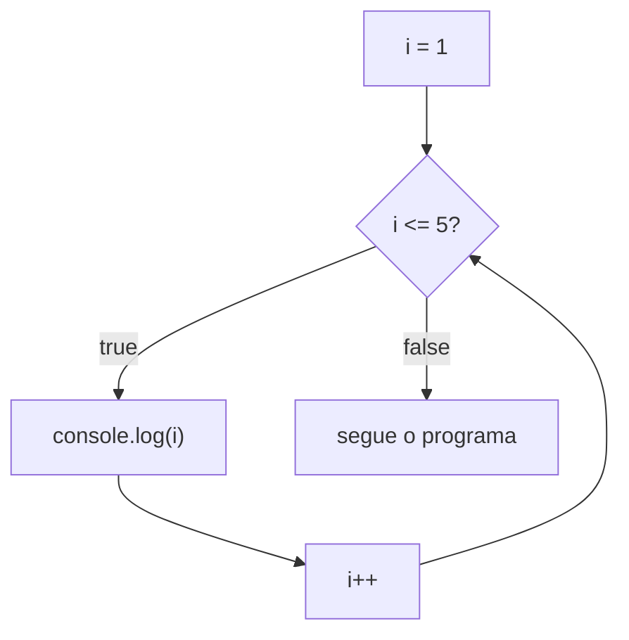

Primeira aula do módulo 4, o das repetições. O módulo 2 ensinou a **guardar** valores, e o módulo 3, a **escolher** um caminho. Falta uma terceira coisa que quase todo programa faz: **repetir**. Mostrar cem números, perguntar a senha até a pessoa acertar, passar por todos os produtos de um carrinho. É a mesma ação, feita de novo e de novo.

## O jeito braçal: copiar e colar

Para mostrar os números de 1 a 5, você já sabe o caminho:

```js
console.log(1);
console.log(2);
console.log(3);
console.log(4);
console.log(5);
```

Funciona. Agora o pedido muda para "de 1 a 100". Dá para copiar e colar a linha cem vezes, mas veja o que vem junto:

1. **O código cresce junto com a tarefa.** Cem números, cem linhas. Dez mil números, dez mil linhas.
2. **Um erro passa despercebido.** Basta um descuido no meio da colagem:

   ```js
   console.log(46);
   console.log(47);
   console.log(47); // era para ser 48
   console.log(49);
   ```

   Não aparece mensagem de erro nenhuma. O programa roda, mostra o 47 duas vezes e pula o 48. No meio de cem linhas quase iguais, ninguém repara.
3. **Mudar dá trabalho.** Se o pedido virar "mostre `Número 1`, `Número 2`...", são cem linhas para editar, uma por uma, com cem chances de errar.
4. **Às vezes, nem dá para saber quantas linhas escrever.** "Peça a senha até a pessoa acertar": quantas vezes? Uma, se ela acertar de primeira. Dez, se errar nove. Copiar e colar exige saber o número **antes** de o programa rodar.

## A saída: o laço

Um **[[glossario/laco|laço]]** (em inglês, *loop*) é um trecho de código que o computador repete **enquanto uma condição for verdadeira**. Você escreve a ação uma vez só, e o computador cuida de repetir.

```js
for (let i = 1; i <= 100; i++) {
  console.log(i);
}
```

Essas três linhas mostram os números de 1 a 100. Para ir até 10.000, o código continua com três linhas: só o `100` vira `10000`. E os quatro problemas de cima somem:

1. O código não cresce com a tarefa.
2. O 47 repetido não tem como acontecer, porque quem escreve os números é o computador.
3. Para mostrar `Número 1`, `Número 2`..., basta mudar uma linha: `console.log("Número", i);`.
4. Para o caso da senha, existe um laço que não precisa saber o número de voltas: o `while`, da aula 4.2.

> [!warning] Cuidado com o ponto nos números grandes
> Em português, escrevemos 10.000 para dez mil. No código, o ponto separa as **casas decimais**, como se viu na aula 2.1. Então `10.000` é o número dez, com três zeros depois da vírgula:
>
> ```js
> console.log(10.000); // 10
> ```
>
> Um laço com `i <= 10.000` dá só 10 voltas, e nenhuma mensagem de erro avisa. Escreva `10000`, sem ponto, ou `10_000`: o JavaScript aceita o sublinhado como separador, só para facilitar a leitura.

## A receita: três peças

Pense no esconde-esconde. Quem vai procurar fecha os olhos e conta até 10. Essa contagem tem três peças:

1. **Um começo**: a contagem começa no 1.
2. **Uma condição**: **enquanto** o número não passar de 10, continua contando.
3. **Uma mudança a cada volta**: depois de falar um número, passa para o próximo.

Cada peça faz falta:

- Sem o começo, não se sabe de onde contar.
- Sem a condição, a contagem não tem hora para acabar.
- Sem a mudança, a criança fala "1, 1, 1, 1..." para sempre. O número nunca chega ao 10, então a condição nunca deixa de valer. Isso se chama **laço infinito**, e é um dos assuntos da aula 4.2.

A mesma receita aparece em qualquer repetição do dia a dia:

| Situação | Começo | Condição: enquanto... | O que muda a cada volta |
|---|---|---|---|
| contar até 10 no esconde-esconde | o número 1 | o número não passou de 10 | vem o próximo número |
| beber um copo de água | o copo cheio | ainda tem água no copo | sai um gole |
| dar 5 voltas na quadra | nenhuma volta dada | deu menos de 5 voltas | mais uma volta dada |

### As três peças no código

```js
for (let i = 1; i <= 5; i++) {
  console.log(i);
}
```

Dentro dos parênteses do `for` estão as três peças, separadas por ponto e vírgula:

| Peça | No código | O que faz |
|---|---|---|
| começo | `let i = 1` | cria a variável `i`, valendo 1 |
| condição | `i <= 5` | enquanto `i` for até 5, o bloco roda |
| mudança | `i++` | soma 1 ao `i` depois de cada volta |
| o que se repete | `{ console.log(i); }` | o [[glossario/bloco\|bloco]], como no `if` |

O `for` é uma [[glossario/palavra-reservada|palavra reservada]], como o `if` da aula 3.1: faz parte da própria linguagem e não pode virar nome de variável. `let for = 5;` dá `SyntaxError: Unexpected token 'for'`. Já o `i` não é reservado. É um nome de variável comum, escolhido por quem escreve o código.

O `i++` é novidade. É um atalho para `i = i + 1`, aquela linha da aula 2.1 que seria absurda na matemática: pega o valor de `i`, soma 1 e guarda de volta no `i`. Os dois sinais de mais se leem "mais um".

```js
let i = 1;
i++;            // o mesmo que i = i + 1
console.log(i); // 2
```

Por enquanto, basta reconhecer as três peças. A aula 4.3 explica o `for` em detalhe.

### Volta a volta

Veja o que o computador faz com esse laço, do começo ao fim:

| Volta | `i` vale | `i <= 5`? | O que acontece |
|---|---|---|---|
| 1ª | 1 | `true` | mostra 1, e o `i` vira 2 |
| 2ª | 2 | `true` | mostra 2, e o `i` vira 3 |
| 3ª | 3 | `true` | mostra 3, e o `i` vira 4 |
| 4ª | 4 | `true` | mostra 4, e o `i` vira 5 |
| 5ª | 5 | `true` | mostra 5, e o `i` vira 6 |
| (fim) | 6 | `false` | o laço termina, e o programa segue |

Repare na última linha. A pergunta é feita **seis** vezes, e o bloco roda **cinco**. A sexta pergunta é a que dá `false`, e é ela que encerra o laço.

> [!info]- Por que a variável se chama `i`? (clique para abrir)
> O nome é livre. Este laço faz exatamente o mesmo:
>
> ```js
> for (let numero = 1; numero <= 5; numero++) {
>   console.log(numero);
> }
> ```
>
> O `i` é costume. Na matemática, as letras *i*, *j* e *k* marcam a posição de um item numa sequência: o 1º, o 2º, o 3º... E muita gente lê o *i* como a inicial de **índice**. Na programação, o costume ganhou força com o Fortran, uma das primeiras linguagens, lançada em 1957. Nele, toda variável cujo nome começava com I, J, K, L, M ou N era automaticamente um número inteiro, e os contadores de laço precisavam ser inteiros. Até hoje, o `i` é o nome mais comum para a variável que conta as voltas.

## O desenho do laço

Na aula 3.1, o fluxograma do `if` tinha dois caminhos que se juntavam **embaixo**, e o programa seguia para baixo. No laço, o caminho do `true` faz a curva e **volta para cima**, para a mesma pergunta:



Dá para pensar no laço como um `if` que, depois de rodar o bloco, volta para perguntar de novo. Só sai dali quando a resposta for `false`.

Com isso, você conhece os três jeitos de um programa andar:

| Jeito de andar | O que faz | Onde aparece no curso |
|---|---|---|
| sequência | uma linha depois da outra | módulos 1 e 2 |
| decisão | escolhe um caminho e pula o outro | módulo 3: `if`, `switch` |
| repetição | volta e faz de novo | módulo 4: `while`, `for` |

Essa lista não é só uma arrumação do curso. Em 1966, os italianos Corrado Böhm e Giuseppe Jacopini mostraram que essas três formas bastam para escrever **qualquer** algoritmo. O resultado é conhecido como teorema da programação estruturada.

## Quando usar um laço

O sinal é perceber que você vai "fazer a mesma coisa várias vezes". No enunciado de um problema, costumam aparecer pistas como "de 1 a 100", "10 vezes", "cada", "todos", "até que" e "enquanto". Três casos que vão aparecer muito:

- **Uma sequência de números.** A tabuada do 7, por exemplo, usando a [[glossario/template-string|template string]] da aula 2.2:

  ```js
  for (let i = 1; i <= 10; i++) {
    console.log(`7 x ${i} = ${7 * i}`);
  }
  // 7 x 1 = 7
  // 7 x 2 = 14
  // ...
  // 7 x 10 = 70
  ```

- **Repetir até dar certo.** Pedir a senha até a pessoa acertar. O número de voltas é desconhecido, e é aí que entra o `while`, da aula 4.2.
- **Passar por uma lista, item por item.** Os nomes de uma turma, os produtos de um carrinho. É o assunto do módulo 6.

E quando **não** é laço? Quando a ação acontece uma vez só, ou quando o problema é escolher entre caminhos. "Diga se a nota é de aprovado" é trabalho do `if`. Já "diga, para cada aluno da turma, se a nota é de aprovado" junta os dois: um laço que passa pelos alunos e, dentro dele, um `if`.

## Volta, repetição, iteração

Cada passada pelo bloco é uma **volta** do laço. O nome técnico é **[[glossario/iteracao|iteração]]**: "o laço deu cinco voltas" e "o laço fez cinco iterações" dizem a mesma coisa. O verbo é **iterar**: "iterar sobre uma lista" é passar por ela item por item.

> [!tip] Iteração não é interação
> As duas palavras só diferem pelo *n*, mas não têm nada a ver uma com a outra. **Iteração** é repetição: fazer de novo. **Interação** é *inter* + *ação*, a ação entre dois lados, como a conversa entre a pessoa e o programa.

Em Portugal, também se diz **ciclo** para o laço: "um ciclo `for`".

## Lógica ou JavaScript?

Toda linguagem tem um jeito de repetir. Muda a forma de escrever as três peças:

| A ideia | JavaScript | Python | Pseudocódigo | Planilha (Excel) |
|---|---|---|---|---|
| contar de 1 a 5 | `for (let i = 1; i <= 5; i++) { ... }` | `for i in range(1, 6):` | `para i de 1 ate 5 faca ... fimpara` | `=SEQUÊNCIA(5)` |

- **No Python**, o `range(1, 6)` para **antes** do segundo número. Para chegar ao 5, é preciso escrever 6. Com `range(1, 5)`, a contagem vai só de 1 a 4.
- **No pseudocódigo**, as três peças viram uma frase: "para `i` de 1 até 5, faça". A mudança, somar 1, fica subentendida.
- **Na planilha**, as fórmulas não têm laço. O jeito antigo era digitar 1 e 2 em duas células e arrastar a alcinha do canto da seleção para baixo: o copiar e colar das planilhas. Nas versões mais novas do Excel (2021 e Microsoft 365), a função `SEQUÊNCIA(5)` preenche a coluna com 1, 2, 3, 4 e 5 sozinha.

## Treine

Tente responder antes de abrir a resposta, logo abaixo de cada pergunta.

> [!question] 1. Quantas linhas?
> Sem laço, quantas linhas de `console.log` seriam necessárias para mostrar os números de 1 a 50? E quantas linhas tem este código, que faz o mesmo?
>
> ```js
> for (let i = 1; i <= 50; i++) {
>   console.log(i);
> }
> ```
>
> > [!success]- Resposta
> > Sem laço, 50 linhas, uma para cada número. Com o laço, 3 linhas. E continuariam 3 linhas para mostrar de 1 a 5000: só o `50` mudaria.

> [!question] 2. O que aparece no console?
> ```js
> for (let i = 1; i <= 3; i++) {
>   console.log("Olá");
> }
> ```
>
> > [!success]- Resposta
> > `Olá` três vezes, uma em cada volta. O bloco nem usa o `i`: aqui, ele só conta as voltas.

> [!question] 3. O que aparece no console?
> ```js
> for (let i = 1; i <= 3; i++) {
>   console.log(i * 10);
> }
> ```
>
> > [!success]- Resposta
> > `10`, `20` e `30`, um em cada linha. Na 1ª volta, o `i` vale 1, e 1 × 10 dá 10. Na 2ª, vale 2. Na 3ª, vale 3.

> [!question] 4. O que aparece no console? E onde estão as três peças?
> O `i--` é o contrário do `i++`: tira 1 do `i`.
>
> ```js
> for (let i = 5; i >= 1; i--) {
>   console.log(i);
> }
> ```
>
> > [!success]- Resposta
> > `5`, `4`, `3`, `2` e `1`: uma contagem regressiva. O começo é `let i = 5`, a condição é `i >= 1` e a mudança é `i--`. Quando o `i` vira 0, `0 >= 1` dá `false`, e o laço termina.

> [!question] 5. O que aparece no console?
> Repare no sinal da condição:
>
> ```js
> for (let i = 1; i < 5; i++) {
>   console.log(i);
> }
> ```
>
> > [!success]- Resposta
> > `1`, `2`, `3` e `4`. O 5 fica de fora: quando o `i` chega a 5, `5 < 5` dá `false`. Para incluir o 5, a condição seria `i <= 5`. É o mesmo cuidado com as bordas da aula 3.3.

> [!question] 6. O que aparece no console?
> ```js
> for (let i = 10; i <= 5; i++) {
>   console.log(i);
> }
> console.log("fim");
> ```
>
> > [!success]- Resposta
> > Só `fim`. Na primeira pergunta, `10 <= 5` já dá `false`, então o bloco roda **zero** vezes. Um laço pode não dar volta nenhuma.

> [!question] 7. Quantas voltas este laço dá?
> A pessoa queria contar até dez mil:
>
> ```js
> for (let i = 1; i <= 10.000; i++) {
>   console.log(i);
> }
> ```
>
> > [!success]- Resposta
> > Só 10. No código, o ponto separa as casas decimais, então `10.000` é o número dez. O certo é `10000` ou `10_000`.

> [!question] 8. Laço ou não?
> (a) Mostrar "Bem-vindo!" quando o programa abre. (b) Mostrar os números de 1 a 20. (c) Perguntar a senha até a pessoa acertar. (d) Dizer se uma nota é de aprovado.
>
> > [!success]- Resposta
> > (a) Não: acontece uma vez só. (b) Laço. (c) Laço, mesmo sem saber quantas vezes: é o caso do `while`, da aula 4.2. (d) Não: é uma escolha, trabalho do `if`.

> [!question] 9. Onde estão as três peças?
> "Enquanto houver prato sujo na pia, lave um prato." Qual é o começo, a condição e o que muda a cada volta? E o que aconteceria se a pessoa só molhasse o prato e o devolvesse à pia?
>
> > [!success]- Resposta
> > O começo é a pia com os pratos sujos. A condição é "ainda tem prato sujo na pia". O que muda é que, a cada volta, sai um prato sujo. Se a pessoa devolvesse o prato à pia, o número de pratos sujos nunca diminuiria, e a louça não acabaria nunca: um laço infinito.

## De onde vêm as palavras

- **[[glossario/laco|Laço]]**: do latim *laqueus*, "laço de corda, armadilha", pelo latim vulgar *laceus*. São da mesma família o espanhol *lazo* e o inglês *lace*, "cadarço", que chegou ao inglês pelo francês antigo *las*. E o *lasso* do inglês, o laço do vaqueiro, veio do espanhol *lazo*. No código, o laço é o caminho que faz a curva e se fecha sobre si mesmo, como uma alça de corda.
- **Loop**: do inglês médio *loupe*, "laço, nó", de origem nórdica. A fonte é o nórdico antigo *hlaup*, "corrida", usado no sentido de **nó corrediço**, o nó que corre pela corda e aperta quando se puxa. *Hlaup* vem de *hlaupa*, "saltar, correr", primo do inglês *leap*, "salto". Curiosamente, *loop* e *laço* começaram os dois como nós de corda.
- **Repetir**: do latim *repetere*, *re-* ("de novo") + *petere* ("ir em direção a, buscar, pedir, atacar"). Primeiro, *repetere* era "voltar a atacar, voltar a algo". Depois, "recomeçar, fazer de novo". O *petere* está em toda uma família: **pedir**, **petição**, **apetite**, **competir** e **ímpeto**.
- **[[glossario/iteracao|Iteração]]**: do latim *iterāre*, "fazer pela segunda vez, repetir", de *iterum*, "de novo, outra vez". Lá no fundo, *iterum* vem de uma raiz indo-europeia que queria dizer "outro". Iterar é fazer **outra** vez.
- **Volta**: de *voltar*, do latim vulgar *vol(vi)tāre*, que vem do latim *volvere*, "rolar, girar". O *volvere* também está em **envolver**, **devolver**, **revólver**, o do tambor que gira, e **evolução**. E o latim *volūmen*, "rolo, livro", é parente: os livros antigos eram rolos que se desenrolavam para ler.
- **Ciclo**: do latim tardio *cyclus*, do grego *kýklos*, "círculo, roda". A raiz indo-europeia, *\*kʷékʷlos*, "roda", está também na **bicicleta**, a de duas rodas, e no inglês *wheel*, "roda".

> [!tip] Para guardar
> - Um laço repete um bloco de código enquanto uma condição for verdadeira. Você escreve uma vez, e o computador repete.
> - Todo laço tem três peças: um começo, uma condição e algo que muda a cada volta, até a condição virar `false`.
> - Sem a mudança, a condição nunca fica falsa, e o laço não termina: é o laço infinito.
> - A pergunta é feita uma vez a mais do que o bloco roda. A última pergunta, a que dá `false`, encerra o laço.
> - `i++` é o mesmo que `i = i + 1`.
> - No código, `10.000` é dez. Para dez mil, escreva `10000` ou `10_000`.
> - Cada volta é uma iteração. Iteração é repetir. Interação é outra coisa.

Fontes: MDN: [Loops and iteration](https://developer.mozilla.org/en-US/docs/Web/JavaScript/Guide/Loops_and_iteration), [for](https://developer.mozilla.org/en-US/docs/Web/JavaScript/Reference/Statements/for), [Numeric separators](https://developer.mozilla.org/en-US/docs/Web/JavaScript/Reference/Lexical_grammar#numeric_separators) · Wikipedia: [Fortran](https://en.wikipedia.org/wiki/Fortran), [Structured program theorem](https://en.wikipedia.org/wiki/Structured_program_theorem) · Microsoft: [Função SEQUÊNCIA](https://support.microsoft.com/pt-br/office/fun%C3%A7%C3%A3o-sequ%C3%AAncia-57467a98-57e0-4817-9f14-2eb78519ca90) · Wiktionary: [laço](https://en.wiktionary.org/wiki/la%C3%A7o), [laqueus](https://en.wiktionary.org/wiki/laqueus), [lace](https://en.wiktionary.org/wiki/lace), [loop](https://en.wiktionary.org/wiki/loop), [repetō](https://en.wiktionary.org/wiki/repeto), [petō](https://en.wiktionary.org/wiki/peto), [iterō](https://en.wiktionary.org/wiki/itero), [iterum](https://en.wiktionary.org/wiki/iterum), [volta](https://en.wiktionary.org/wiki/volta), [volūmen](https://en.wiktionary.org/wiki/volumen), [ciclo](https://en.wiktionary.org/wiki/ciclo)
